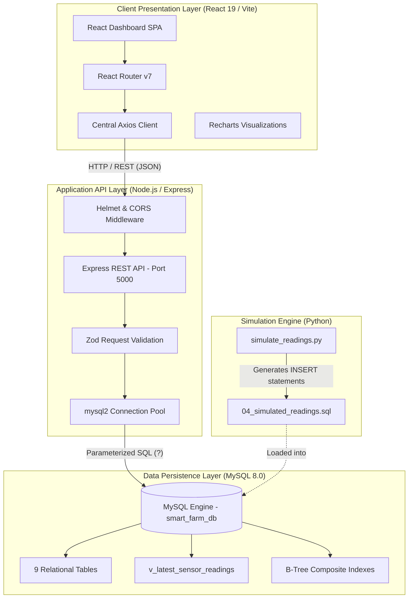
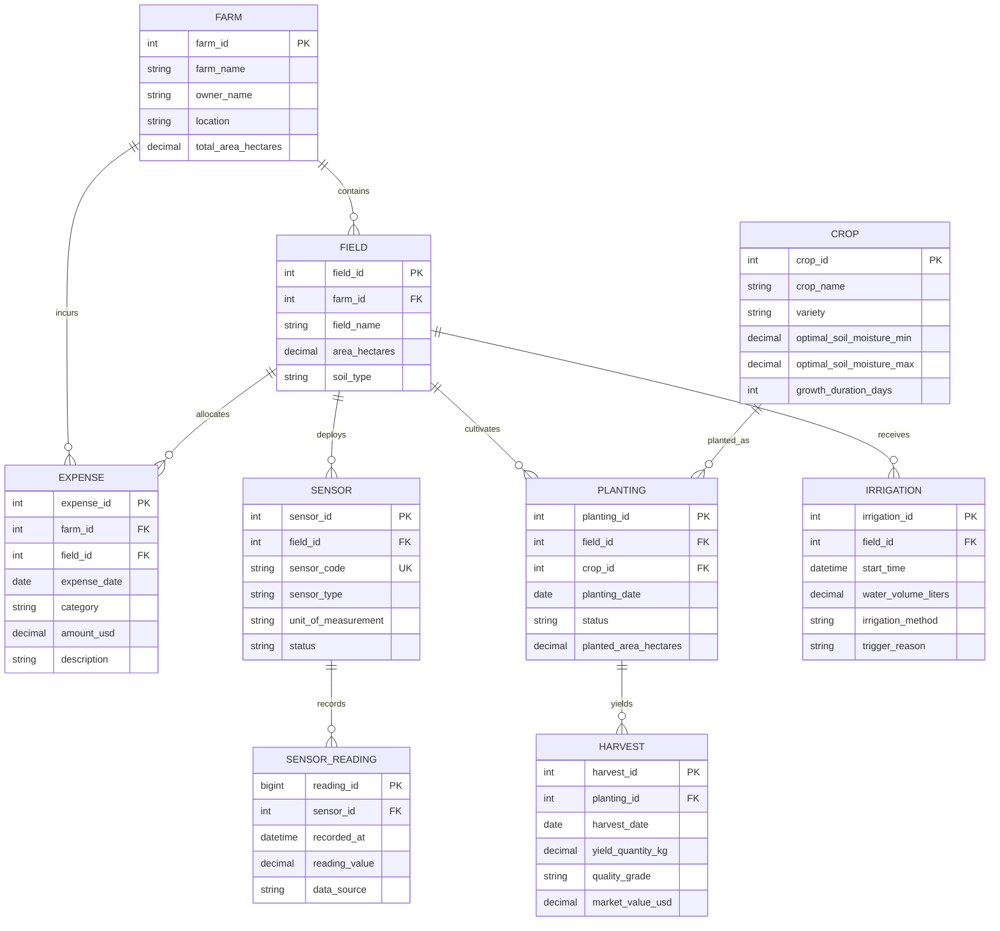

# Smart Farm Database Management System

A comprehensive, full-stack precision agriculture management system and telemetry dashboard powered by **MySQL 8**, **Node.js / Express**, and **React 19 / Vite / Tailwind CSS**.

Developed as an academic Database Management System (DBMS) mini-project, this application demonstrates the practical application of relational database architecture, data integrity, SQL analytics, and full-stack software engineering to real-world agrarian operations.

---

## 📑 Table of Contents

1. [Project Overview](#-project-overview)
2. [Why the Name "Smart Farm Database Management System" Fits](#-why-the-name-smart-farm-database-management-system-fits)
3. [Why This Is a Strong DBMS Mini-Project](#-why-this-is-a-strong-dbms-mini-project)
4. [DBMS Concepts Demonstrated](#-dbms-concepts-demonstrated)
5. [System Architecture](#-system-architecture)
6. [Database Schema & ER Diagram](#-database-schema--er-diagram)
7. [Technology Stack](#-technology-stack)
8. [Key Features](#-key-features)
9. [Project Directory Structure](#-project-directory-structure)
10. [Local Installation & Setup Guide](#-local-installation--setup-guide)
11. [Environment Configuration](#-environment-configuration)
12. [REST API Documentation](#-rest-api-documentation)
13. [Python Sensor Telemetry Simulator](#-python-sensor-telemetry-simulator)
14. [Testing & Verification Evidence](#-testing--verification-evidence)
15. [Deployment Guide (Vercel & Render)](#-deployment-guide-vercel--render)
16. [Security & Data Integrity Practices](#-security--data-integrity-practices)
17. [Limitations & Future Enhancements](#-limitations--future-enhancements)
18. [Viva Exam Demonstration Guide](#-viva-exam-demonstration-guide)
19. [Academic Conclusion](#-academic-conclusion)
20. [License & Attribution](#-license--attribution)

---

## 🌾 Project Overview

In traditional agriculture, operational records—such as field parcel boundaries, crop planting rotations, soil moisture logs, irrigation water delivery, produce harvests, and input expenditures—are typically scattered across handwritten notebooks, disconnected spreadsheets, or isolated paper receipts. This fragmentation leads to:
- **Data Redundancy & Inconsistency:** Conflicting acreage figures or crop varieties across documents.
- **Lack of Referential Integrity:** Harvests recorded for crops never planted, or irrigation logged on non-existent fields.
- **Inability to Perform Analytics:** Inability to correlate soil moisture deficits with water delivery or calculate true net farm income ($ \text{Revenue} - \text{Expenses} $).

The **Smart Farm Database Management System** solves this by establishing a centralized, normalized MySQL relational database (`smart_farm_db`) as the single source of truth. A REST API backend bridges this schema to a responsive React dashboard, enabling farm managers and agricultural researchers to inspect live telemetry, detect low-moisture deficits, execute analytical reports, and manage operational records through an intuitive interface.

> **Note on Project Scope:**  
> In this academic implementation, "Smart Farm" refers to a structured agrarian management system supported by database-driven analytics, mathematical aggregations, and simulated IoT sensor telemetry. It does not imply physical embedded hardware microcontrollers or proprietary cloud AI systems.

---

## 🏷️ Why the Name "Smart Farm Database Management System" Fits

The project title accurately reflects every layer of the implementation:

### 1. "Smart Farm"
- **Unified Agrarian Modeling:** Farms, soil plots, botanical crop catalogs, and cultivation cycles are organized into structured relationships.
- **Telemetry Monitoring:** Environmental sensors track soil moisture, air temperature, humidity, and light intensity.
- **Deficit Alerts:** Automated decision-support alerts identify soil moisture levels below the target threshold ($30.0\%$), advising immediate irrigation review.
- **Operational Integration:** Links moisture deficits directly to irrigation water volume, harvest yields, and input costs.

### 2. "Database Management System"
- **Normalized Relational Engine:** Powered by MySQL 8 (InnoDB), enforcing 1NF, 2NF, and 3NF compliance across 9 tables.
- **Referential Integrity:** Enforced Primary Keys and cascading Foreign Keys prevent orphan records.
- **Domain Constraints:** Schema-level `CHECK` constraints prevent negative acres, invalid moisture ranges ($0-100\%$), or negative revenue.
- **Advanced SQL Analytics:** Utilizes multi-table `JOIN`s, `GROUP BY` aggregations, SQL window functions (`ROW_NUMBER()`), and database `VIEW`s (`v_latest_sensor_readings`).

### 3. "Management System"
- **Full Operational Lifecycle:** Supports creation, inspection, modification, and safe deletion (CRUD) of agrarian entities.
- **Application Services Layer:** An Express backend coordinates transactions, validates incoming payloads using Zod, and sanitizes inputs.
- **Intuitive Web Interface:** A responsive React dashboard presents data via metric cards, interactive Recharts visualizations, data tables, and CSV exports.

---

## 🏆 Why This Is a Strong DBMS Mini-Project

This project surpasses typical academic database assignments by demonstrating end-to-end integration rather than isolated SQL queries:

1. **Complete Relational Ecosystem:** Models 9 distinct real-world entities with realistic 1-to-many relationships (Farm $\rightarrow$ Fields $\rightarrow$ Sensors $\rightarrow$ Readings; Crops $\rightarrow$ Plantings $\rightarrow$ Harvests).
2. **True Mathematical Reconciliations:** Dashboard and report totals are computed dynamically by the database engine (e.g., $ \sum \text{Yield} = 76,500\text{ kg} $, $ \sum \text{Revenue} = \$27,270 $, $ \sum \text{Expense} = \$6,690 $, $ \text{Net Income} = \$20,580 $). Zero numbers are hardcoded or fabricated.
3. **Rigorous Data Integrity:** Enforces physical bounds at the database level (e.g., moisture $ \ge 0\% \land \le 100\% $; planted area $ > 0 $; crop thermal bounds $ \text{max} \ge \text{min} $).
4. **Window Functions & Views:** Solves the classic "Greatest-n-per-group" problem by querying the exact latest sensor reading using subqueries and SQL window functions, codified into a persistent database view.
5. **Foreign Key Conflict Handling:** Attempting to delete a farm that has child fields returns an explicit HTTP 409 conflict, demonstrating referential integrity enforcement to the user.
6. **Zero-Dependency Telemetry Simulator:** Includes a standalone Python script generating deterministic, benchmark-labeled (`SIMULATED`) sensor readings without requiring external Python packages or physical IoT hardware.
7. **Comprehensive Test Automation:** Validated by 16 automated backend integration tests and 11 static Python tests, achieving 100% pass rates.

---

## 📊 DBMS Concepts Demonstrated

| DBMS Concept | Implementation in Smart Farm DBMS |
| :--- | :--- |
| **Relational Schema (3NF)** | 9 normalized tables eliminating update, insertion, and deletion anomalies. |
| **Primary Keys (PK)** | `farm_id`, `field_id`, `crop_id`, `planting_id`, `sensor_id`, `reading_id`, `irrigation_id`, `harvest_id`, `expense_id`. |
| **Foreign Keys (FK)** | `field.farm_id`, `sensor.field_id`, `sensor_reading.sensor_id`, `planting.crop_id`, `planting.field_id`, `harvest.planting_id`, `expense.farm_id`. |
| **Referential Integrity** | `ON UPDATE CASCADE` and `ON DELETE RESTRICT` prevent orphaned sensor readings or planting cycles. |
| **Domain Constraints (`CHECK`)** | `area_hectares > 0`, `reading_value BETWEEN 0 AND 100` (for soil moisture), `water_volume_liters >= 0`, `amount_usd > 0`. |
| **Unique Constraints (`UNIQUE`)** | `sensor.sensor_code`, ensuring unique hardware identifiers across all fields. |
| **Multi-Table `JOIN`s** | 4-table inner join (`harvest` $\bowtie$ `planting` $\bowtie$ `crop` $\bowtie$ `field` $\bowtie$ `farm`) aggregating crop revenue per farm. |
| **Aggregate Functions** | `SUM()`, `AVG()`, `COUNT()`, and `COALESCE()` for computing yields, revenues, and transaction averages. |
| **Subqueries** | Correlated subqueries used to isolate `MAX(reading_id)` per sensor for real-time telemetry alerts. |
| **Window Functions** | `ROW_NUMBER() OVER (PARTITION BY sensor_id ORDER BY recorded_at DESC)` in analytical reports. |
| **Database Views** | `v_latest_sensor_readings` encapsulates complex joins into a virtual relational view. |
| **Composite B-Tree Indexes** | `idx_reading_sensor_time (sensor_id, recorded_at)` and `idx_planting_dates (crop_id, planting_date)` for fast query execution. |
| **SQL Injection Prevention** | 100% parameterized SQL prepared statements (`?` placeholders via `mysql2/promise`). |
| **Application-Layer Validation** | Schema mirroring via Zod validators before queries reach MySQL. |

---

## 🏗️ System Architecture



---

## 🗄️ Database Schema & ER Diagram

The database models 9 normalized tables:

1. **`farm`**: Top-level agrarian property (`farm_id`, `farm_name`, `owner_name`, `location`, `total_area_hectares`, `created_at`).
2. **`field`**: Cultivation parcel belonging to a farm (`field_id`, `farm_id`, `field_name`, `area_hectares`, `soil_type`, `created_at`).
3. **`crop`**: Botanical cultivar catalog (`crop_id`, `crop_name`, `variety`, `optimal_soil_moisture_min`, `optimal_soil_moisture_max`, `optimal_temp_celsius_min`, `optimal_temp_celsius_max`, `growth_duration_days`).
4. **`planting`**: Crop cultivation cycle (`planting_id`, `field_id`, `crop_id`, `planting_date`, `expected_harvest_date`, `status`, `planted_area_hectares`, `notes`).
5. **`sensor`**: Hardware telemetry node (`sensor_id`, `field_id`, `sensor_code`, `sensor_type`, `unit_of_measurement`, `status`, `installation_date`).
6. **`sensor_reading`**: Time-series measurement (`reading_id`, `sensor_id`, `recorded_at`, `reading_value`, `data_source`, `is_valid`).
7. **`irrigation`**: Water delivery log (`irrigation_id`, `field_id`, `start_time`, `end_time`, `water_volume_liters`, `irrigation_method`, `trigger_reason`, `notes`).
8. **`harvest`**: Produce yield log (`harvest_id`, `planting_id`, `harvest_date`, `yield_quantity_kg`, `quality_grade`, `market_value_usd`, `notes`).
9. **`expense`**: Operational expenditure (`expense_id`, `farm_id`, `field_id`, `expense_date`, `category`, `amount_usd`, `description`).

### Entity-Relationship Diagram



---

## 💻 Technology Stack

| Component | Technology | Version | Purpose in Project |
| :--- | :--- | :--- | :--- |
| **Database Engine** | MySQL Server | `8.0.46` | Relational storage, referential integrity, views, indexes |
| **Backend Runtime** | Node.js | `24.18.0` | Server-side JavaScript runtime |
| **Backend Framework** | Express.js | `5.0.0` | REST API routes, middleware, centralized error handling |
| **Database Driver** | `mysql2/promise` | `3.11.0` | Connection pooling, prepared statements |
| **Input Validation** | Zod | `3.23.8` | Schema validation for query parameters and JSON bodies |
| **Frontend Framework** | React | `19.2.8` | Component-based interactive dashboard SPA |
| **Build Bundler** | Vite (Rolldown) | `8.3.4` | Development HMR and fast production asset compilation |
| **Styling** | Tailwind CSS | `@tailwindcss/vite` | Custom precision-agriculture styling and responsive grid |
| **Client Routing** | React Router | `7.x` | Declarative client-side routing across 11 application pages |
| **HTTP Client** | Axios | `1.x` | Reusable client with timeouts and error interceptors |
| **Chart Visualizations**| Recharts | `2.x` | Responsive SVG charts (moisture bars, financial comparisons) |
| **Iconography** | Lucide React | `Latest` | Consistent agricultural and hardware UI iconography |
| **Simulation Script** | Python | `3.11+` | Deterministic telemetry generator (`seed=42`, zero external dependencies) |

---

## ✨ Key Features

| Feature | Description | Stack Layer | Status |
| :--- | :--- | :--- | :---: |
| **Consolidated Dashboard** | Displays real-time KPIs: farms, fields, plantings, sensors, yields, revenues, expenses, net income, and active moisture deficit alerts. | Full Stack | **Verified** |
| **Moisture Deficit Alerts** | Real-time threshold evaluation ($30.0\%$) flagging sensors with low moisture; interactive threshold slider. | Full Stack | **Verified** |
| **Farms Management** | Register, view attached fields, edit, and safely delete farms with foreign key conflict protections. | Full Stack | **Verified** |
| **Fields Management** | Divide farms into subplots, specify soil composition, and inspect child sensors and planting cycles. | Full Stack | **Verified** |
| **Crop Catalog** | Botanical reference of crops, varieties, moisture ranges, and thermal bounds with domain validation. | Full Stack | **Verified** |
| **Planting Cycles** | Track active (`GROWING`), planned, and harvested crop cycles connected to specific fields. | Full Stack | **Verified** |
| **Sensor Registry** | Register hardware telemetry nodes, select measurement units, and monitor node operational states. | Full Stack | **Verified** |
| **Telemetry Ingestion** | Ingest telemetry records with physical range checks ($0-100\%$ for moisture) and provenance tags (`SIMULATED` vs `REAL`). | Full Stack | **Verified** |
| **Irrigation Logs** | Record water volume (liters), delivery methods (Drip/Sprinkler/Flood), and automated/manual triggers. | Full Stack | **Verified** |
| **Harvest Records** | Log produce yield weight (kg), quality grade assessment (A/B/C), and calculate gross revenue. | Full Stack | **Verified** |
| **Expense Tracking** | Categorize operational expenditures (Fertilizer, Seeds, Labor, Hardware) linked to farms and fields. | Full Stack | **Verified** |
| **Analytical SQL Reports** | Tabbed analytical reports (Harvest Performance, Expense Breakdown, Agronomics, Irrigation). | Full Stack | **Verified** |
| **Client-Side CSV Export** | Export any displayed report dataset directly to downloadable `.csv` spreadsheets. | Frontend | **Verified** |
| **Database Health Ping** | Top header continuously polls `/api/health` displaying live connection status (`MySQL 8.x Connected`). | Full Stack | **Verified** |

---

## 📁 Project Directory Structure

```text
DBMS- Project/
├── .gitignore                      # Root Git exclusion rules (protects .env and build output)
├── README.md                       # Master project documentation
│
├── sql/                            # Executable MySQL scripts
│   ├── 01_schema.sql               # DDL: Database creation, 9 tables, constraints, indexes
│   ├── 02_sample_data.sql          # DML: Idempotent demonstration seed data (INSERT IGNORE)
│   ├── 03_reports.sql              # 10 core SQL analytical demonstrations & view creation
│   └── 04_simulated_readings.sql   # Synthetic telemetry readings with low moisture breaches
│
├── simulator/                      # Telemetry simulation engine
│   └── simulate_readings.py        # Zero-dependency Python telemetry generator (seed=42)
│
├── tests/                          # Quality assurance & verification
│   ├── test_validation.py          # Static AST and SQL constraint test suite (unittest)
│   ├── test_plan.md                # Comprehensive test strategy and verification matrix
│   └── test_results.md             # Detailed execution audit log
│
├── docs/                           # Academic reports and presentation assets
│   ├── project_report.md           # 18-section academic DBMS mini-project report
│   ├── project_report.html         # Word-compatible formatted report
│   ├── presentation_outline.md     # 8-slide viva presentation deck with talking points
│   ├── viva_questions.md           # 20 viva examination questions with concise answers
│   ├── DEMO_GUIDE.md               # 5-minute timed live demonstration script
│   ├── FINAL_AUDIT.md              # Phase 5 pre-handover verification audit
│   ├── PHASE_5_FINAL_HANDOVER.md   # Deployment blueprints and cloud migration guide
│   ├── PHASE_4_FRONTEND_REPORT.md  # React frontend architecture and build report
│   └── PHASE_3_BACKEND_REPORT.md   # Express REST API backend engineering report
│
├── backend/                        # Node.js + Express REST API Backend
│   ├── src/
│   │   ├── config/database.js      # mysql2 connection pool & health checker
│   │   ├── middleware/             # Central error handling & Zod validation
│   │   ├── routes/                 # 11 modular entity and report route files
│   │   ├── utils/response.js       # Standardized JSON response envelope
│   │   ├── validators/             # Zod schema definitions
│   │   ├── app.js                  # Express application setup, Helmet, CORS
│   │   └── server.js               # HTTP listener with graceful shutdown
│   ├── tests/                      # Automated API integration tests (node:test)
│   │   ├── api.test.js
│   │   └── validation.test.js
│   ├── .env.example                # Safe environment variable template
│   ├── package.json
│   └── render.yaml                 # Render cloud deployment blueprint
│
└── frontend/                       # React 19 + Vite + Tailwind CSS Frontend SPA
    ├── src/
    │   ├── components/             # Reusable UI components (Cards, Modals, Badges, Tables)
    │   ├── context/                # ToastContext notification provider
    │   ├── pages/                  # 11 application route pages
    │   ├── services/               # Central Axios client & 11 modular API services
    │   ├── utils/                  # Formatters (currency, dates, weights) & CSV exporter
    │   ├── App.jsx                 # Route tree definitions
    │   ├── index.css               # Tailwind directives & precision agriculture CSS tokens
    │   └── main.jsx                # React DOM entry point
    ├── .env.example                # Safe frontend environment variable template
    ├── package.json
    ├── vercel.json                 # Vercel SPA routing rewrite rules
    └── vite.config.js              # Vite build configuration with chunking
```

---

## 🚀 Local Installation & Setup Guide

### Prerequisites
- **Node.js** v18+ or v24+ and **npm**
- **MySQL Server 8.x** running on `localhost:3306` (e.g., MySQL Community Server or MySQL Workbench)
- **Python 3.10+** (standard library only, for sensor simulation)
- **Git**

---

### Step 1: Clone the Repository
```powershell
git clone https://github.com/Rahul84825/DBMS.git
cd DBMS
```

---

### Step 2: Initialize the MySQL Database
Open **MySQL Workbench** or the **MySQL Command Line Client** and execute the scripts in order:

```powershell
# 1. Create database schema, tables, constraints, and indexes
mysql -u root -p < "sql\01_schema.sql"

# 2. Seed initial demonstration master data
mysql -u root -p smart_farm_db < "sql\02_sample_data.sql"

# 3. Load simulated sensor telemetry readings
mysql -u root -p smart_farm_db < "sql\04_simulated_readings.sql"

# 4. Create database views and run analytical reports
mysql -u root -p smart_farm_db < "sql\03_reports.sql"
```

---

### Step 3: Configure and Start the Backend API
```powershell
cd backend

# Install dependencies
npm install

# Create local environment configuration
cp .env.example .env

# Edit .env and enter your local MySQL root password:
# DB_PASSWORD=your_actual_mysql_password

# Start backend in development mode (with hot reloading)
npm run dev
```
The backend API will start on **`http://localhost:5000`**.  
Verify health: Open `http://localhost:5000/api/health` in your browser.

---

### Step 4: Configure and Start the React Frontend
In a **new terminal window**:
```powershell
cd frontend

# Install dependencies
npm install

# Create local environment configuration
cp .env.example .env

# Start Vite development server
npm run dev
```
The React frontend dashboard will start at **`http://localhost:5173`**.

---

## ⚙️ Environment Configuration

### Backend Environment Variables (`backend/.env`)

| Variable | Default Value | Description |
| :--- | :--- | :--- |
| `PORT` | `5000` | Port for the Express REST API server |
| `NODE_ENV` | `development` | Runtime environment (`development` or `production`) |
| `DB_HOST` | `localhost` | MySQL server hostname |
| `DB_PORT` | `3306` | MySQL server port |
| `DB_USER` | `root` | MySQL database user |
| `DB_PASSWORD` | *(Required)* | MySQL user password |
| `DB_NAME` | `smart_farm_db` | Target relational database name |
| `DB_CONNECTION_LIMIT`| `10` | Maximum connections in the `mysql2` pool |
| `CORS_ORIGIN` | `http://localhost:3000,http://localhost:5173` | Allowed frontend origins (comma-separated) |
| `DEFAULT_MOISTURE_ALERT_THRESHOLD` | `30.0` | Default soil moisture alert baseline (%) |

### Frontend Environment Variables (`frontend/.env`)

| Variable | Default Value | Description |
| :--- | :--- | :--- |
| `VITE_API_BASE_URL` | `http://localhost:5000/api/v1` | Public API base URL consumed by Axios client |

> 🔒 **Security Notice:**  
> Never commit `.env` files to version control. Both `backend/.env` and `frontend/.env` are strictly excluded by the root `.gitignore`.

---

## 📡 REST API Documentation

All API routes are mounted under the prefix `/api/v1`.

### 1. System Health & Discovery
- `GET /api/health` — Returns system uptime and live MySQL connection status (`200 OK` or `503 Service Unavailable`).
- `GET /api` — Returns API version and available endpoint catalog.

### 2. Consolidated Dashboard & Reports
- `GET /api/v1/dashboard/summary?threshold=30.0` — Consolidated multi-entity counts, financials, active moisture deficit alerts, and recent irrigation events.
- `GET /api/v1/reports/harvests` — Aggregate harvest yields and revenue by crop variety.
- `GET /api/v1/reports/expenses` — Operational expenditures grouped by farm and category.
- `GET /api/v1/reports/crops` — Botanical requirements and active cultivation acreage.
- `GET /api/v1/reports/irrigation` — Cumulative water volume applied by field and irrigation method.

### 3. Core Entities (CRUD)
| Entity | Method | Endpoint | Description |
| :--- | :---: | :--- | :--- |
| **Farms** | `GET` | `/api/v1/farms` | List farms with search and pagination |
| | `GET` | `/api/v1/farms/:id` | Get farm details with attached fields |
| | `POST` | `/api/v1/farms` | Register a new farm |
| | `PUT` | `/api/v1/farms/:id` | Update farm details |
| | `DELETE` | `/api/v1/farms/:id` | Safe delete (enforces foreign key checks) |
| **Fields** | `GET` | `/api/v1/fields` | List fields with parent farm join and filters |
| | `GET` | `/api/v1/fields/:id` | Get field details with attached sensors and plantings |
| | `POST` | `/api/v1/fields` | Add a new field parcel |
| | `PUT` | `/api/v1/fields/:id` | Update field parcel |
| | `DELETE` | `/api/v1/fields/:id` | Safe delete field parcel |
| **Crops** | `GET` | `/api/v1/crops` | List crop varieties in catalog |
| | `POST` | `/api/v1/crops` | Register new crop with moisture/temp bounds |
| | `PUT` | `/api/v1/crops/:id` | Update crop catalog parameters |
| | `DELETE` | `/api/v1/crops/:id` | Safe delete crop |
| **Plantings** | `GET` | `/api/v1/plantings` | List planting cycles with crop/field joins |
| | `POST` | `/api/v1/plantings` | Record a new planting cycle |
| | `PUT` | `/api/v1/plantings/:id` | Update planting cycle status |
| | `DELETE` | `/api/v1/plantings/:id` | Safe delete planting cycle |
| **Sensors** | `GET` | `/api/v1/sensors` | List registered sensor units |
| | `POST` | `/api/v1/sensors` | Register new sensor hardware node |
| | `PUT` | `/api/v1/sensors/:id` | Update sensor hardware node |
| | `DELETE` | `/api/v1/sensors/:id` | Safe delete sensor node |
| **Readings** | `GET` | `/api/v1/readings` | Historical telemetry records with pagination |
| | `GET` | `/api/v1/readings/latest` | Isolate single newest reading per sensor |
| | `GET` | `/api/v1/readings/alerts?threshold=30` | Active soil moisture deficit alerts |
| | `POST` | `/api/v1/readings` | Ingest new telemetry measurement |
| **Irrigation** | `GET` | `/api/v1/irrigation` | List water delivery logs |
| | `POST` | `/api/v1/irrigation` | Record new irrigation event |
| **Harvests** | `GET` | `/api/v1/harvests` | List produce harvest logs |
| | `POST` | `/api/v1/harvests` | Record harvest yield and revenue |
| **Expenses** | `GET` | `/api/v1/expenses` | List operational expenditure logs |
| | `POST` | `/api/v1/expenses` | Record input expenditure |

---

## 🐍 Python Sensor Telemetry Simulator

The project includes a pure Python telemetry generator (`simulator/simulate_readings.py`) that uses only the Python Standard Library (`random`, `datetime`, `pathlib`).

### Simulator Features:
- **Deterministic Output:** Uses a fixed random seed (`seed=42`) ensuring reproducible demonstration datasets.
- **Data Provenance Labeling:** Tags all generated rows explicitly as `SIMULATED` to distinguish them from potential physical IoT hardware readings.
- **Calculated Deficit Breaches:** Deliberately generates low-moisture readings (e.g., $24.50\%$) on designated sensors to demonstrate automated alert detection.
- **SQL File Generation:** Outputs clean, valid SQL `INSERT` statements formatted for direct execution in MySQL Workbench.

### Execution Command:
```powershell
python simulator/simulate_readings.py
```
This updates `sql/04_simulated_readings.sql` with a refreshed batch of synthetic measurements.

---

## 🧪 Testing & Verification Evidence

All test suites and verification checks have been executed and verified:

```text
======================================================================
1. BACKEND REST API TESTS (Node.js test runner)
======================================================================
Command: cd backend && npm test
Results:
✔ GET /api/health returns health status (70ms)
✔ GET /api returns API catalog and endpoints list (8ms)
✔ GET /api/v1/nonexistent returns 404 error response (7ms)
✔ POST /api/v1/farms fails with 400 when missing required fields (16ms)
✔ POST /api/v1/farms fails with 400 on negative area_hectares (9ms)
✔ GET /api/v1/farms/:id fails with 400 on non-numeric ID (8ms)
✔ POST /api/v1/readings fails with 400 when missing sensor (9ms)
✔ POST /api/v1/crops fails with 400 if optimal_soil_moisture_max < min (7ms)
✔ CORS headers are properly applied (8ms)
✔ GET /api/v1/readings/alerts rejects negative threshold with 400 (46ms)
✔ GET /api/v1/readings/alerts rejects threshold > 100 with 400 (8ms)
✔ POST /api/v1/expenses rejects invalid expense category with 400 (23ms)
✔ POST /api/v1/expenses rejects non-positive amount with 400 (9ms)
✔ POST /api/v1/irrigation rejects negative water_volume_liters with 400 (9ms)
✔ POST /api/v1/harvests rejects negative yield_quantity_kg with 400 (8ms)
✔ POST /api/v1/fields rejects non-positive area_hectares with 400 (6ms)
Total: 16 passed, 0 failed (Duration: 738ms)

======================================================================
2. STATIC SCHEMA & SIMULATOR TESTS (Python unittest)
======================================================================
Command: python -m unittest tests/test_validation.py
Results:
Ran 11 tests in 0.178s
Status: OK (100% Passing)

======================================================================
3. FRONTEND PRODUCTION BUILD (Vite / Rolldown)
======================================================================
Command: cd frontend && npm run build
Results:
✓ 2587 modules transformed.
dist/index.html                             1.42 kB │ gzip:   0.69 kB
dist/assets/index-CnZz4IRo.css             41.25 kB │ gzip:   7.96 kB
dist/assets/rolldown-runtime-hePW80VL.js    0.71 kB │ gzip:   0.42 kB
dist/assets/icons-zjORaFsI.js              15.06 kB │ gzip:   5.57 kB
dist/assets/index-GLuL0sRi.js             168.64 kB │ gzip:  29.98 kB
dist/assets/vendor-CXtFaO7C.js            296.46 kB │ gzip:  96.68 kB
dist/assets/charts-CQv_4zSl.js            367.97 kB │ gzip: 106.77 kB
Status: Build succeeded in 919ms with 0 errors and 0 warnings.
```

---

## 🌐 Deployment Guide (Vercel & Render)

### A. Deploying Frontend to Vercel
1. Import repository into **Vercel**.
2. Set **Root Directory** to `frontend`.
3. Set **Framework Preset** to `Vite`.
4. Ensure Build Command is `npm run build` and Output Directory is `dist`.
5. Add Environment Variable:
   - `VITE_API_BASE_URL`: URL of your deployed Express backend (e.g., `https://smart-farm-api.onrender.com/api/v1`).
6. The included `frontend/vercel.json` automatically handles client-side SPA routing rewrites.

### B. Deploying Backend to Render
1. Create a new **Web Service** on **Render** linked to this repository.
2. Select **Root Directory** as `backend`.
3. Environment: `Node`.
4. Build Command: `npm install`.
5. Start Command: `npm start`.
6. Add required environment variables in Render dashboard:
   - `NODE_ENV=production`
   - `PORT=5000`
   - `DB_HOST`, `DB_PORT`, `DB_USER`, `DB_PASSWORD`, `DB_NAME` (Pointing to your cloud MySQL database).
   - `CORS_ORIGIN=https://your-frontend-app.vercel.app`

### C. Cloud Database Requirement
> ⚠️ **Cloud Deployment Note:**  
> A backend hosted on Render or AWS cannot connect to `localhost:3306` running on your local personal computer. For a public online deployment, host the MySQL database on a cloud service (e.g., **Aiven for MySQL**, **Railway**, or **AWS RDS**) and import `sql/01_schema.sql`, `sql/02_sample_data.sql`, and `sql/04_simulated_readings.sql`.

---

## 🔒 Security & Data Integrity Practices

1. **SQL Injection Prevention:** 100% of SQL statements utilize parameterized queries via the `mysql2/promise` driver. User input is never concatenated directly into SQL strings.
2. **Strict Request Validation:** All route parameters, queries, and JSON request bodies are validated against strict Zod schemas before database queries execute.
3. **HTTP Security Headers:** `helmet` middleware sets secure HTTP headers (`Content-Security-Policy`, `X-Frame-Options`, `Strict-Transport-Security`).
4. **CORS Whitelisting:** Configurable CORS restricts browser API access strictly to authorized frontend origins.
5. **Referential Integrity Protection:** Route handlers check for child foreign key dependencies before attempting deletions, providing user-friendly HTTP 409 conflict messages instead of raw database crashes.
6. **Secret Isolation:** Environment files (`.env`) are strictly excluded from version control via `.gitignore`.

---

## ⚠️ Limitations & Future Enhancements

### Current Limitations:
- **Simulated Environmental Readings:** Telemetry data is generated synthetically; no physical microcontrollers (ESP32/Arduino) are connected.
- **Authentication Scope:** As an educational DBMS mini-project, role-based login (RBAC) was excluded to keep evaluation focused on database architecture.
- **Local Database Binding:** Default configuration runs against local MySQL (`localhost:3306`).

### Future Enhancements:
- **Physical IoT Telemetry:** MQTT ingestion pipeline connecting physical LoRaWAN or ESP32 soil probes.
- **Automated Actuator Triggers:** Relay hardware to actuate solenoid valves when low-moisture alerts fire.
- **Role-Based Access Control (RBAC):** JWT authentication distinguishing farm owners, field agronomists, and system administrators.
- **Predictive Yield Analytics:** Integration of machine learning models forecasting crop yields based on cumulative thermal units and moisture levels.

---

## 🎓 Viva Exam Demonstration Guide

### Recommended 5-Minute Demonstration Sequence:

1. **Problem Statement & Concept (1 min):**
   - Explain how agricultural data is traditionally fragmented.
   - Introduce `smart_farm_db` as a centralized 3NF relational database.
2. **Schema & Relationships (1 min):**
   - Open MySQL Workbench and show the 9 tables.
   - Explain primary and foreign keys linking Farms $\rightarrow$ Fields $\rightarrow$ Plantings $\rightarrow$ Harvests.
3. **Live Dashboard & Data Verification (1 min):**
   - Open the React dashboard (`http://localhost:5173`).
   - Show how dashboard counts match live database records (2 farms, 4 fields, 4 crops, 6 sensors, 33 readings).
   - Demonstrate the low moisture deficit alert ($24.50\% < 30.0\%$).
4. **CRUD & Constraint Demonstration (1 min):**
   - Add a new field or crop variety through the web form.
   - Show input validation rejecting invalid values (e.g., negative acreage).
   - Attempt to delete a parent farm with child fields to show the HTTP 409 referential integrity conflict.
5. **SQL Reports & View Inspection (1 min):**
   - Open the Reports tab and show the Harvest Yield and Expense Breakdown charts.
   - Export report data to CSV to demonstrate data portability.
   - Explain how `v_latest_sensor_readings` solves the greatest-n-per-group telemetry problem.

### Common Viva Questions & Answers:

- **Q: Why is your schema in Third Normal Form (3NF)?**  
  *A: Every table has a primary key (1NF), all non-key attributes are fully functionally dependent on the entire primary key (2NF), and there are no transitive dependencies (3NF). For example, farm location is stored only in `farm`, not duplicated in `field` or `planting`.*

- **Q: How does the system isolate the latest reading for each sensor?**  
  *A: It uses a correlated subquery finding `MAX(reading_id)` grouped by `sensor_id`, joined back to `sensor_reading`. This avoids Cartesian products and guarantees exactly one latest record per sensor.*

- **Q: How are SQL injection attacks prevented?**  
  *A: The backend uses parameterized prepared statements with `?` placeholders through `mysql2/promise`. Input parameters are sent separately from the SQL statement structure.*

- **Q: What happens if you try to delete a farm that has fields attached?**  
  *A: The backend verifies foreign key dependencies. If child records exist, it rejects the deletion with an HTTP 409 conflict error, preserving referential integrity.*

---

## 🏁 Academic Conclusion

The **Smart Farm Database Management System** demonstrates that database management concepts are most meaningful when integrated into a functional, end-to-end software application. 

By unifying relational database modeling, constraint enforcement, SQL window functions, virtual views, Express REST APIs, simulated IoT telemetry, and a React dashboard, this project bridges database theory with practical full-stack engineering. It represents a robust, fully verified, and academically rigorous DBMS mini-project.

---

## 📜 License & Attribution

This project is open-source and created for academic demonstration purposes under the **MIT License**.

- **Author / Student:** Rahul / DBMS Academic Team
- **Database Engine:** MySQL 8.x
- **Academic Subject:** Database Management Systems (DBMS Mini-Project)
