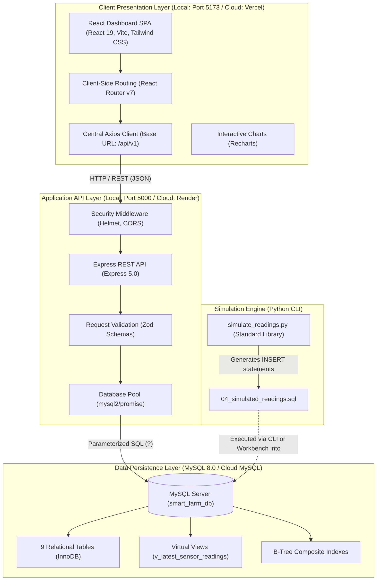
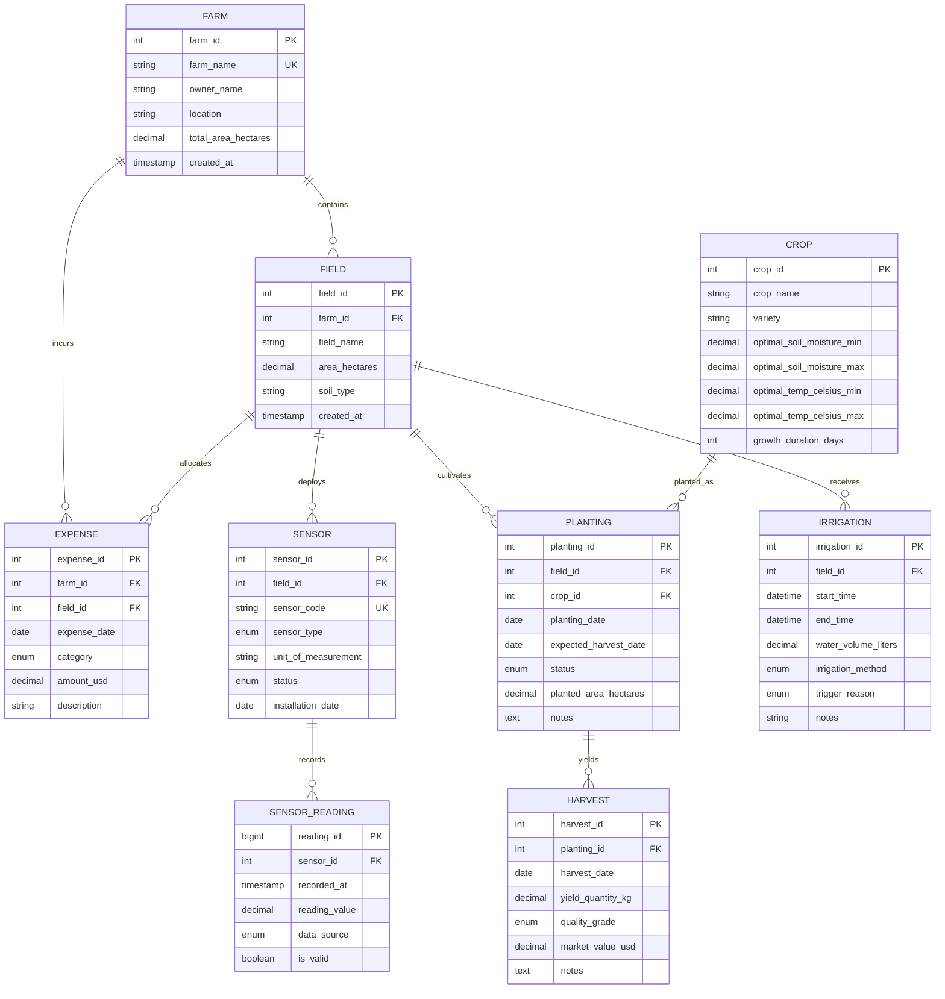

# Smart Farm Database Management System

A comprehensive, full-stack precision agriculture management system and telemetry dashboard powered by **MySQL 8**, **Node.js / Express**, and **React / Vite / Tailwind CSS**.

Developed as an academic Database Management System (DBMS) mini-project, this application demonstrates the practical application of relational database architecture, data integrity, SQL analytics, and full-stack software engineering to real-world agrarian operations.

---

## Table of Contents

1. [Project Overview](#project-overview)
2. [Why the Name "Smart Farm Database Management System" Fits](#why-the-name-smart-farm-database-management-system-fits)
3. [Key Features](#key-features)
4. [Why This Is a Strong DBMS Mini-Project](#why-this-is-a-strong-dbms-mini-project)
5. [DBMS Concepts Demonstrated](#dbms-concepts-demonstrated)
6. [System Architecture](#system-architecture)
7. [Database Design](#database-design)
8. [Technology Stack](#technology-stack)
9. [Project Folder Structure](#project-folder-structure)
10. [Installation and Local Setup](#installation-and-local-setup)
11. [Environment Variables](#environment-variables)
12. [API Documentation](#api-documentation)
13. [Running the Python Sensor Simulator](#running-the-python-sensor-simulator)
14. [Testing and Verification](#testing-and-verification)
15. [Deployment](#deployment)
16. [Security and Data Safety](#security-and-data-safety)
17. [Limitations and Future Enhancements](#limitations-and-future-enhancements)
18. [Viva Demonstration Guide](#viva-demonstration-guide)
19. [Academic Value and Conclusion](#academic-value-and-conclusion)
20. [License and Contribution](#license-and-contribution)

---

## Project Overview

In traditional agriculture, operational records—such as farm ownership, field parcel boundaries, crop planting rotations, soil moisture telemetry, irrigation water delivery, produce harvests, and input expenditures—are typically scattered across handwritten notebooks, disconnected spreadsheets, or isolated paper receipts. This fragmentation causes several critical data management issues:

- **Data Redundancy & Inconsistency:** Conflicting acreage figures, duplicated crop varieties, or divergent dates across disconnected documents.
- **Lack of Referential Integrity:** Harvests recorded for crops that were never planted, or irrigation logged on non-existent field parcels.
- **Inability to Perform Analytics:** Inability to correlate soil moisture deficits with water delivery volume, or calculate true net farm income ($\text{Revenue} - \text{Expenses}$) across cultivation cycles.

The **Smart Farm Database Management System** solves this problem by establishing a centralized, normalized MySQL relational database (`smart_farm_db`) as the single source of truth. A REST API backend bridges this schema to a responsive React dashboard, enabling farm managers and agricultural researchers to inspect live telemetry, detect low-moisture deficits, execute analytical reports, and manage operational records through an intuitive user interface.

> **Note on Project Scope:**  
> In this implementation, "Smart Farm" refers to a structured agrarian management system supported by database-driven analytics, mathematical aggregations, and simulated IoT sensor telemetry. It does not imply physical embedded hardware microcontrollers, automated solenoid valves, or proprietary cloud artificial intelligence systems.

---

## Why the Name "Smart Farm Database Management System" Fits

The project title directly reflects every layer of the implementation:

### 1. Smart Farm
- **Unified Agrarian Modeling:** Farms, field parcels, botanical crop catalogs, and cultivation cycles are organized together into structured relationships.
- **Telemetry Monitoring:** Environmental sensors track soil moisture, air temperature, humidity, and light intensity.
- **Deficit Alerts:** Automated decision-support alerts highlight soil moisture levels below a configurable demonstration threshold ($30.0\%$), advising immediate irrigation review.
- **Operational Integration:** Links moisture deficits directly to irrigation water volume, harvest yields, and operational input costs.

### 2. Database Management System
- **Normalized Relational Engine:** Powered by MySQL 8 (InnoDB), enforcing 1NF, 2NF, and 3NF compliance across 9 distinct tables.
- **Referential Integrity:** Enforced Primary Keys and cascading/restricting Foreign Keys prevent orphan records.
- **Domain Constraints:** Schema-level `CHECK` constraints prevent negative acres, invalid moisture ranges ($0-100\%$), or negative revenue.
- **Advanced SQL Analytics:** Utilizes multi-table `JOIN`s, `GROUP BY` aggregations, SQL window functions (`ROW_NUMBER()`), and database `VIEW`s (`v_latest_sensor_readings`).

### 3. Management System
- **Full Operational Lifecycle:** Supports creation, inspection, modification, and safe deletion (CRUD) of agrarian entities.
- **Application Services Layer:** An Express backend coordinates database operations, validates incoming payloads using Zod schemas, and standardizes error responses.
- **Intuitive Web Interface:** A responsive React dashboard presents data through metric cards, interactive Recharts visualizations, paginated tables, and CSV exports.

---

## Key Features

The following matrix documents all features in the application, categorizing their implementation state and supporting architectural layer:

| Feature | Description | Stack Layer | Status |
| :--- | :--- | :--- | :---: |
| **Consolidated Dashboard** | Displays real-time KPIs: farms, fields, plantings, sensors, yields, revenues, expenses, net income, and active moisture deficit alerts. | Full Stack | **Implemented & Verified** |
| **Moisture Deficit Alerts** | Real-time threshold evaluation ($30.0\%$) flagging sensors with low moisture; interactive threshold slider. | Full Stack | **Implemented & Verified** |
| **Farm Management** | Register, view attached fields, edit, and safely delete farms with foreign key conflict protections. | Full Stack | **Implemented & Verified** |
| **Field Management** | Divide farms into subplots, specify soil composition, and inspect child sensors and planting cycles. | Full Stack | **Implemented & Verified** |
| **Crop Catalog** | Botanical reference of crops, varieties, moisture ranges, and thermal bounds with domain validation. | Full Stack | **Implemented & Verified** |
| **Planting Lifecycle** | Track active (`GROWING`), planned, and harvested crop cycles connected to specific fields. | Full Stack | **Implemented & Verified** |
| **Sensor Hardware Registry** | Register hardware telemetry nodes, select measurement units, and monitor node operational states. | Full Stack | **Implemented & Verified** |
| **Telemetry Ingestion** | Ingest telemetry records with physical range checks ($0-100\%$ for moisture) and provenance tags (`SIMULATED` vs `REAL`). | Full Stack | **Implemented & Verified** |
| **Latest Telemetry View** | Virtual database view isolating the single newest reading per sensor for real-time monitoring. | MySQL / API | **Implemented & Verified** |
| **Irrigation Logs** | Record water volume (liters), delivery methods (Drip/Sprinkler/Flood), and automated/manual triggers. | Full Stack | **Implemented & Verified** |
| **Harvest & Yield Records** | Log produce yield weight (kg), quality grade assessment (A/B/C), and calculate gross revenue. | Full Stack | **Implemented & Verified** |
| **Expense Tracking** | Categorize operational expenditures (Fertilizer, Seeds, Labor, Hardware) linked to farms and fields. | Full Stack | **Implemented & Verified** |
| **Analytical SQL Reports** | Tabbed analytical reports (Harvest Performance, Expense Breakdown, Agronomics, Irrigation). | Full Stack | **Implemented & Verified** |
| **Client-Side CSV Export** | Export any displayed report dataset directly to downloadable `.csv` spreadsheets. | Frontend | **Implemented & Verified** |
| **Database Health Ping** | Top header continuously polls `/api/health` displaying live connection status (`MySQL 8.x Connected`). | Full Stack | **Implemented & Verified** |
| **Telemetry Simulator** | Standalone Python script generating deterministic, benchmark-labeled (`SIMULATED`) telemetry readings. | Python / SQL | **Implemented & Verified** |
| **Physical IoT Hardware** | Real ESP32 / LoRaWAN microcontrollers sending sensor data over radio frequencies. | Hardware | *Planned / Unavailable* |
| **Automated Solenoid Valves**| Physical valve actuation driven by database triggers or microcontroller relays. | Hardware | *Planned / Unavailable* |
| **ML Yield Forecasting** | Machine learning prediction models forecasting crop yield from historical climate data. | Data Science | *Planned / Unavailable* |
| **Role-Based Access Control**| Multi-user authentication distinguishing farm owners, agronomists, and guests. | Auth Layer | *Planned / Unavailable* |

---

## Why This Is a Strong DBMS Mini-Project

This project combines database design, SQL proficiency, application integration, and data analysis to demonstrate academic DBMS excellence:

1. **Real-World Application:** The database models a recognizable agricultural management problem where data integrity directly impacts food production and resource stewardship.
2. **Relational Database Design:** Models 9 distinct entities with realistic 1-to-many and many-to-many relationships (Farm $\rightarrow$ Fields $\rightarrow$ Sensors $\rightarrow$ Readings; Crops $\rightarrow$ Plantings $\rightarrow$ Harvests).
3. **Primary and Foreign Keys:** Relationships are established through explicit primary keys and foreign keys with specified referential actions (`ON UPDATE CASCADE`, `ON DELETE RESTRICT`, `ON DELETE CASCADE`).
4. **Data Integrity:** Physical bounds are enforced at the database level using `CHECK` constraints (e.g., moisture $ \ge 0\% \land \le 100\% $; area $ > 0 $; thermal bounds $ \text{max} \ge \text{min} $; water volume $ \ge 0 $).
5. **SQL Proficiency:** Demonstrates `SELECT`, `INSERT`, `UPDATE`, multi-table `JOIN`s, filtering, grouping, aggregate functions (`SUM`, `AVG`, `COUNT`), subqueries, and window functions.
6. **Analytical Queries:** Computes operational metrics dynamically: $ \sum \text{Yield} = 76,500\text{ kg} $, $ \sum \text{Revenue} = \$27,270 $, $ \sum \text{Expense} = \$6,690 $, and $ \text{Net Income} = \$20,580 $.
7. **Views and Advanced SQL:** Solves the classic "Greatest-n-per-group" problem by querying the exact latest sensor reading using subqueries, codified into a persistent database view (`v_latest_sensor_readings`).
8. **Full-Stack Integration:** React communicates with Express over HTTP/JSON, and Express communicates with MySQL using parameterized prepared queries.
9. **Data Simulation:** Python standard library generates benchmark-labeled (`SIMULATED`) telemetry without requiring physical hardware or third-party packages.
10. **Data Validation and Safe Operations:** Layered validation prevents invalid data from entering the database: Zod validates incoming payloads at the API layer, while MySQL constraints enforce physical bounds at the storage layer. Foreign key deletion conflicts return explicit HTTP 409 responses.
11. **Testing and Documentation:** Fully verified with 16 automated backend tests, 11 Python schema/simulator tests, and complete phase audit documentation.
12. **Demonstrability:** A student can easily demonstrate database tables, run analytical queries in MySQL Workbench, inspect foreign key constraints, and show live updates in the web dashboard during a viva examination.

---

## DBMS Concepts Demonstrated

| DBMS Concept | How It Is Used in This Project |
| :--- | :--- |
| **Relational Tables** | 9 normalized tables: `farm`, `field`, `crop`, `planting`, `sensor`, `sensor_reading`, `irrigation`, `harvest`, and `expense`. |
| **Primary Keys (PK)** | Uniquely identifies each record via auto-increment integers (`farm_id`, `field_id`, `crop_id`, `planting_id`, `sensor_id`, `reading_id`, `irrigation_id`, `harvest_id`, `expense_id`). |
| **Foreign Keys (FK)** | Maintains relationships: `field.farm_id`, `sensor.field_id`, `sensor_reading.sensor_id`, `planting.crop_id`, `planting.field_id`, `harvest.planting_id`, `expense.farm_id`, and `expense.field_id`. |
| **Referential Integrity** | Configured with `ON UPDATE CASCADE` and `ON DELETE RESTRICT` to prevent orphan records, `ON DELETE CASCADE` for time-series telemetry, and `ON DELETE SET NULL` for optional field expenses. |
| **Domain Constraints (`CHECK`)**| Enforces data bounds: `area_hectares > 0`, `reading_value BETWEEN 0 AND 100`, `water_volume_liters >= 0`, `amount_usd > 0`, and `optimal_temp_celsius_max >= optimal_temp_celsius_min`. |
| **Unique Constraints (`UNIQUE`)**| `farm.farm_name`, `crop(crop_name, variety)`, `field(farm_id, field_name)`, and `sensor.sensor_code`. |
| **Normalization (1NF, 2NF, 3NF)** | **1NF:** All attributes are atomic; no repeating groups.<br>**2NF:** All non-key attributes are fully dependent on the primary key.<br>**3NF:** No transitive dependencies (e.g., farm details stored in `farm`, not duplicated in `field` or `planting`). |
| **Many-to-Many Resolution** | The M:N relationship between `field` and `crop` across time is resolved via the associative entity table `planting`. |
| **CRUD Operations** | `INSERT`, `SELECT`, `UPDATE`, and `DELETE` executed across all entities via parameterized statements. |
| **Multi-Table `JOIN`s** | 4-table inner join (`harvest` $\bowtie$ `planting` $\bowtie$ `crop` $\bowtie$ `field` $\bowtie$ `farm`) aggregating crop revenue per farm. |
| **Aggregate Functions** | `SUM()`, `AVG()`, `COUNT()`, and `COALESCE()` used to calculate total yields, financial summaries, and transaction averages. |
| **Subqueries** | Correlated subquery isolating `MAX(reading_id)` per sensor for real-time telemetry alerts. |
| **Window Functions** | `ROW_NUMBER() OVER (PARTITION BY sensor_id ORDER BY recorded_at DESC)` in analytical reports. |
| **Database Views** | `v_latest_sensor_readings` encapsulates multi-table joins into a reusable virtual table. |
| **Composite B-Tree Indexes** | `idx_reading_sensor_time (sensor_id, recorded_at DESC)` and `idx_planting_dates (crop_id, planting_date)` for fast query execution. |
| **Connection Pooling** | `mysql2` connection pool manages reusable database connections with health checking and graceful shutdown. |
| **SQL Injection Prevention** | 100% parameterized SQL prepared statements using `?` placeholders. User input is never concatenated into SQL strings. |
| **Application-Layer Validation**| Zod schemas mirror database rules (positive numbers, valid dates, allowable enum values) before queries execute. |
| **Reporting & Data Aggregation**| Pre-calculated multi-entity summaries driving financial reconciliation and harvest performance. |

---

## System Architecture



### Deployment Configuration Notes:
- **Local Environment:** Frontend runs at `http://localhost:5173`, Backend runs at `http://localhost:5000`, and MySQL runs at `localhost:3306`.
- **Cloud Deployment:** Frontend is configured for **Vercel** (`frontend/vercel.json`), Backend is configured for **Render** (`backend/render.yaml`). A cloud-hosted MySQL database (e.g., Aiven, Railway, AWS RDS) is required for full online operation.

---

## Database Design

The database contains 9 relational tables designed in Third Normal Form (3NF) using the InnoDB storage engine:



### Table Descriptions & Constraints

1. **`farm`**: Represents top-level agricultural properties.
   - **Primary Key:** `farm_id` (INT, AUTO_INCREMENT)
   - **Constraints:** `farm_name` is UNIQUE; `chk_farm_total_area` (`total_area_hectares > 0`).
2. **`crop`**: Botanical catalog storing optimal environmental ranges.
   - **Primary Key:** `crop_id` (INT, AUTO_INCREMENT)
   - **Constraints:** `UNIQUE(crop_name, variety)`; `chk_crop_growth_days` (`growth_duration_days > 0`); `chk_crop_moisture_range` ($0 \le \text{min} \le \text{max} \le 100$); `chk_crop_temp_range` ($\text{max} \ge \text{min}$).
3. **`field`**: Agricultural land parcels belonging to a parent farm.
   - **Primary Key:** `field_id` (INT, AUTO_INCREMENT)
   - **Foreign Key:** `farm_id` $\rightarrow$ `farm(farm_id)` (`ON DELETE RESTRICT`, `ON UPDATE CASCADE`).
   - **Constraints:** `UNIQUE(farm_id, field_name)`; `chk_field_area` (`area_hectares > 0`).
   - **Indexes:** `idx_field_farm` on `(farm_id)`.
4. **`planting`**: Cultivation lifecycle resolving the M:N relationship between fields and crops.
   - **Primary Key:** `planting_id` (INT, AUTO_INCREMENT)
   - **Foreign Keys:** `field_id` $\rightarrow$ `field(field_id)`, `crop_id` $\rightarrow$ `crop(crop_id)`.
   - **Constraints:** `chk_planted_area` (`planted_area_hectares > 0`); `chk_planting_dates` (`expected_harvest_date >= planting_date`).
   - **Indexes:** `idx_planting_field`, `idx_planting_crop`, `idx_planting_status`.
5. **`sensor`**: Physical telemetry node metadata.
   - **Primary Key:** `sensor_id` (INT, AUTO_INCREMENT)
   - **Foreign Key:** `field_id` $\rightarrow$ `field(field_id)`.
   - **Constraints:** `sensor_code` is UNIQUE; `sensor_type` ENUM (`SOIL_MOISTURE`, `AIR_TEMPERATURE`, `HUMIDITY`, `LIGHT`).
   - **Indexes:** `idx_sensor_field`, `idx_sensor_type`.
6. **`sensor_reading`**: High-volume historical time-series measurements.
   - **Primary Key:** `reading_id` (BIGINT, AUTO_INCREMENT)
   - **Foreign Key:** `sensor_id` $\rightarrow$ `sensor(sensor_id)` (`ON DELETE CASCADE`, `ON UPDATE CASCADE`).
   - **Attributes:** `data_source` ENUM (`SIMULATED`, `REAL`), `is_valid` BOOLEAN.
   - **Indexes:** Composite B-tree `idx_reading_sensor_time (sensor_id, recorded_at DESC)`, `idx_reading_recorded_at`.
7. **`irrigation`**: Water application logs.
   - **Primary Key:** `irrigation_id` (INT, AUTO_INCREMENT)
   - **Foreign Key:** `field_id` $\rightarrow$ `field(field_id)`.
   - **Constraints:** `chk_irrigation_water` (`water_volume_liters >= 0`); `chk_irrigation_times` (`end_time >= start_time`).
   - **Indexes:** `idx_irrigation_field`, `idx_irrigation_start_time`.
8. **`harvest`**: Output yield, quality assessment, and market revenue.
   - **Primary Key:** `harvest_id` (INT, AUTO_INCREMENT)
   - **Foreign Key:** `planting_id` $\rightarrow$ `planting(planting_id)`.
   - **Constraints:** `chk_harvest_yield` (`yield_quantity_kg >= 0`); `chk_harvest_value` (`market_value_usd >= 0`).
   - **Indexes:** `idx_harvest_planting`, `idx_harvest_date`.
9. **`expense`**: Operational and input expenditures.
   - **Primary Key:** `expense_id` (INT, AUTO_INCREMENT)
   - **Foreign Keys:** `farm_id` $\rightarrow$ `farm(farm_id)` (`ON DELETE RESTRICT`), `field_id` $\rightarrow$ `field(field_id)` (`ON DELETE SET NULL`).
   - **Constraints:** `chk_expense_amount` (`amount_usd > 0`).
   - **Indexes:** `idx_expense_farm`, `idx_expense_field`, `idx_expense_date`, `idx_expense_category`.

---

## Technology Stack

| Technology | Purpose |
| :--- | :--- |
| **MySQL Server (8.0.46)** | Relational database engine, transaction processing, referential integrity, views, and composite indexes. |
| **Node.js (v24.18.0)** | High-performance asynchronous JavaScript runtime environment for backend services. |
| **Express.js (5.0.0)** | Web application framework for routing, middleware execution, and RESTful API endpoints. |
| **`mysql2/promise` (3.11.0)** | Asynchronous MySQL client providing connection pooling and parameterized prepared statements. |
| **Zod (3.23.8)** | TypeScript-first schema validation library for request payloads, route parameters, and query strings. |
| **React (19.2.8)** | Declarative, component-based user interface library for building the single-page dashboard. |
| **Vite (8.3.4)** | Next-generation frontend build tool and hot-module replacement (HMR) development server. |
| **Tailwind CSS (@tailwindcss/vite)** | Utility-first CSS framework providing a responsive, agricultural-themed design system. |
| **React Router (v7)** | Client-side routing management across all 11 dashboard pages. |
| **Axios (1.x)** | Promise-based HTTP client for browser API requests with centralized error handling. |
| **Recharts (2.x)** | Composable SVG charting library for interactive telemetry bars and financial charts. |
| **Lucide React** | Consistent, accessible SVG iconography throughout dashboard navigation and metric cards. |
| **Python (3.10+)** | Standard library script for generating deterministic, benchmark-labeled simulated sensor readings. |
| **Git & GitHub** | Distributed version control and repository hosting ([Rahul84825/DBMS](https://github.com/Rahul84825/DBMS)). |

---

## Project Folder Structure

```text
DBMS- Project/
├── .gitignore                      # Git exclusion rules (protects .env, node_modules, dist)
├── README.md                       # Master project documentation
│
├── sql/                            # Executable MySQL scripts
│   ├── 01_schema.sql               # DDL: Database creation, 9 tables, constraints, indexes
│   ├── 02_sample_data.sql          # DML: Idempotent demonstration seed data (INSERT IGNORE)
│   ├── 03_reports.sql              # 10 core SQL analytical queries & view creation
│   └── 04_simulated_readings.sql   # Synthetic telemetry readings with low moisture breaches
│
├── simulator/                      # Telemetry simulation engine
│   ├── simulate_readings.py        # Zero-dependency Python telemetry generator (seed=42)
│   └── simulated_readings.sql      # Generated output SQL from simulator
│
├── tests/                          # Quality assurance & verification
│   ├── test_validation.py          # Static AST and SQL constraint test suite (unittest)
│   ├── test_plan.md                # Comprehensive test strategy and verification matrix
│   └── test_results.md             # Detailed execution audit log
│
├── docs/                           # Academic reports and presentation assets
│   ├── project_report.md           # 18-section academic DBMS mini-project report
│   ├── project_report.html         # Word-compatible formatted report
│   ├── presentation_outline.md     # 8-slide viva presentation deck with talking points
│   ├── viva_questions.md           # 20 viva examination questions with concise answers
│   ├── DEMO_GUIDE.md               # 5-minute timed live demonstration script
│   ├── FINAL_AUDIT.md              # Phase 5 pre-handover verification audit
│   ├── PHASE_5_FINAL_HANDOVER.md   # Deployment blueprints and cloud migration guide
│   ├── PHASE_4_FRONTEND_REPORT.md  # React frontend architecture and build report
│   └── PHASE_3_BACKEND_REPORT.md   # Express REST API backend engineering report
│
├── backend/                        # Node.js + Express REST API Backend
│   ├── src/
│   │   ├── config/database.js      # mysql2 connection pool & health checker
│   │   ├── middleware/             # Central error handling & Zod validation
│   │   ├── routes/                 # 11 modular entity and report route files
│   │   ├── utils/response.js       # Standardized JSON response envelope
│   │   ├── validators/             # Zod schema definitions
│   │   ├── app.js                  # Express application setup, Helmet, CORS
│   │   └── server.js               # HTTP listener with graceful shutdown
│   ├── tests/                      # Automated API integration tests (node:test)
│   │   ├── api.test.js
│   │   └── validation.test.js
│   ├── .env.example                # Safe environment variable template
│   ├── package.json
│   └── render.yaml                 # Render cloud deployment blueprint
│
└── frontend/                       # React 19 + Vite + Tailwind CSS Frontend SPA
    ├── src/
    │   ├── components/             # Reusable UI components (Cards, Modals, Badges, Tables)
    │   ├── context/                # ToastContext notification provider
    │   ├── pages/                  # 11 application route pages
    │   ├── services/               # Central Axios client & 11 modular API services
    │   ├── utils/                  # Formatters (currency, dates, weights) & CSV exporter
    │   ├── App.jsx                 # Route tree definitions
    │   ├── index.css               # Tailwind directives & precision agriculture CSS tokens
    │   └── main.jsx                # React DOM entry point
    ├── .env.example                # Safe frontend environment variable template
    ├── package.json
    ├── vercel.json                 # Vercel SPA routing rewrite rules
    └── vite.config.js              # Vite build configuration with chunking
```

---

## Installation and Local Setup

### Prerequisites
- **Node.js** v18+ or v24+ and **npm**
- **MySQL Server 8.x** running locally on port `3306`
- **MySQL Workbench** or MySQL Command Line Client
- **Python 3.10+** (standard library only; required only if regenerating telemetry)
- **Git**

> ⚠️ **Database Safety Warning:**  
> The SQL scripts in `sql/` use `CREATE TABLE IF NOT EXISTS` and `INSERT IGNORE`. They are designed for initial database creation. If your database already contains populated records, do not drop or recreate tables.

---

### Step 1: Clone the Repository
```powershell
git clone https://github.com/Rahul84825/DBMS.git
cd DBMS
```

---

### Step 2: Initialize the Database (First-Time Setup Only)
Open MySQL Command Line Client or PowerShell:

```powershell
# 1. Create database schema, tables, constraints, and indexes
mysql -u root -p < "sql\01_schema.sql"

# 2. Seed initial demonstration master data
mysql -u root -p smart_farm_db < "sql\02_sample_data.sql"

# 3. Load simulated sensor telemetry readings
mysql -u root -p smart_farm_db < "sql\04_simulated_readings.sql"

# 4. Create database views and run analytical reports
mysql -u root -p smart_farm_db < "sql\03_reports.sql"
```

---

### Step 3: Configure and Start the Backend
```powershell
cd backend

# Install dependencies
npm install

# Copy environment template
cp .env.example .env

# Edit .env and set your local MySQL password:
# DB_PASSWORD=your_actual_password

# Start backend in development mode
npm run dev
```
The backend API starts at **`http://localhost:5000`**.  
Verify health by visiting `http://localhost:5000/api/health` in your browser.

---

### Step 4: Configure and Start the Frontend
In a **new terminal window**:
```powershell
cd frontend

# Install dependencies
npm install

# Copy environment template
cp .env.example .env

# Start Vite development server
npm run dev
```
The dashboard will open at **`http://localhost:5173`**.

---

## Environment Variables

### Backend Configuration (`backend/.env`)

| Variable | Default Value | Required | Description |
| :--- | :--- | :---: | :--- |
| `PORT` | `5000` | No | Port on which the Express server listens |
| `NODE_ENV` | `development` | No | Runtime environment (`development` or `production`) |
| `DB_HOST` | `localhost` | No | MySQL hostname |
| `DB_PORT` | `3306` | No | MySQL port |
| `DB_USER` | `root` | No | MySQL database username |
| `DB_PASSWORD` | *(None)* | **Yes** | MySQL user password |
| `DB_NAME` | `smart_farm_db` | No | Database name |
| `DB_CONNECTION_LIMIT` | `10` | No | Maximum connections in connection pool |
| `CORS_ORIGIN` | `http://localhost:3000,http://localhost:5173` | No | Whitelisted CORS frontend origins (comma-separated) |
| `DEFAULT_MOISTURE_ALERT_THRESHOLD` | `30.0` | No | Soil moisture threshold (%) triggering alerts |

### Frontend Configuration (`frontend/.env`)

| Variable | Default Value | Required | Description |
| :--- | :--- | :---: | :--- |
| `VITE_API_BASE_URL` | `http://localhost:5000/api/v1` | **Yes** | Public API base URL consumed by Axios client |

> 🔒 **Security Rules:**  
> 1. Never commit `.env` files to Git. Both `.env` files are excluded by `.gitignore`.  
> 2. `VITE_*` variables are embedded into client-side JavaScript bundles during compilation. **Never place database passwords or private secrets in frontend `.env` files.**

---

## API Documentation

All application endpoints are mounted under the prefix `/api/v1`.

### 1. System Health & Discovery
- `GET /api/health` — Checks database connectivity and returns uptime.
- `GET /api` — Returns API version and available endpoint catalog.

### 2. Dashboard & Reports
- `GET /api/v1/dashboard/summary?threshold=30.0` — Consolidated multi-entity counts, financials, active moisture deficit alerts, and recent irrigation events.
- `GET /api/v1/reports/harvests` — Aggregate harvest yields and revenue by crop variety.
- `GET /api/v1/reports/expenses` — Operational expenditures grouped by farm and category.
- `GET /api/v1/reports/crops` — Botanical requirements and active cultivation acreage.
- `GET /api/v1/reports/irrigation` — Cumulative water volume applied by field and irrigation method.

### 3. Core Entity Routes (CRUD)

| Entity | Method | Endpoint | Description | Type |
| :--- | :---: | :--- | :--- | :---: |
| **Farms** | `GET` | `/api/v1/farms` | List farms with search and pagination (`?page=1&limit=10`) | Read |
| | `GET` | `/api/v1/farms/:id` | Get single farm details with attached fields | Read |
| | `POST` | `/api/v1/farms` | Register a new farm | Write |
| | `PUT` | `/api/v1/farms/:id` | Update farm details | Write |
| | `DELETE` | `/api/v1/farms/:id` | Safe delete (enforces foreign key dependency check) | Write |
| **Fields** | `GET` | `/api/v1/fields` | List fields with parent farm details (`?farm_id=...`) | Read |
| | `GET` | `/api/v1/fields/:id` | Get field details with attached sensors and plantings | Read |
| | `POST` | `/api/v1/fields` | Register a new field parcel | Write |
| | `PUT` | `/api/v1/fields/:id` | Update field parcel | Write |
| | `DELETE` | `/api/v1/fields/:id` | Safe delete field parcel | Write |
| **Crops** | `GET` | `/api/v1/crops` | List crop varieties in catalog | Read |
| | `POST` | `/api/v1/crops` | Register new crop with moisture and temperature bounds | Write |
| | `PUT` | `/api/v1/crops/:id` | Update crop catalog parameters | Write |
| | `DELETE` | `/api/v1/crops/:id` | Safe delete crop | Write |
| **Plantings** | `GET` | `/api/v1/plantings` | List planting cycles with crop/field joins | Read |
| | `POST` | `/api/v1/plantings` | Record a new planting cycle | Write |
| | `PUT` | `/api/v1/plantings/:id` | Update planting cycle status (`GROWING`, `HARVESTED`) | Write |
| | `DELETE` | `/api/v1/plantings/:id` | Safe delete planting cycle | Write |
| **Sensors** | `GET` | `/api/v1/sensors` | List registered sensor units | Read |
| | `POST` | `/api/v1/sensors` | Register new sensor hardware node | Write |
| | `PUT` | `/api/v1/sensors/:id` | Update sensor hardware node | Write |
| | `DELETE` | `/api/v1/sensors/:id` | Safe delete sensor node | Write |
| **Readings** | `GET` | `/api/v1/readings` | Historical telemetry records with pagination | Read |
| | `GET` | `/api/v1/readings/latest` | Query newest reading per sensor via database view | Read |
| | `GET` | `/api/v1/readings/alerts?threshold=30` | Active soil moisture deficit alerts | Read |
| | `POST` | `/api/v1/readings` | Ingest new telemetry measurement | Write |
| **Irrigation** | `GET` | `/api/v1/irrigation` | List water delivery logs | Read |
| | `POST` | `/api/v1/irrigation` | Record new irrigation event | Write |
| **Harvests** | `GET` | `/api/v1/harvests` | List produce harvest logs | Read |
| | `POST` | `/api/v1/harvests` | Record harvest yield and market revenue | Write |
| **Expenses** | `GET` | `/api/v1/expenses` | List operational expenditure logs | Read |
| | `POST` | `/api/v1/expenses` | Record operational expenditure | Write |

### Sample JSON Request & Response

#### 1. Ingest Sensor Reading (`POST /api/v1/readings`)
**Request Body:**
```json
{
  "sensor_id": 1,
  "reading_value": 24.50,
  "data_source": "SIMULATED",
  "is_valid": true
}
```

**Response (`201 Created`):**
```json
{
  "success": true,
  "message": "Sensor reading recorded successfully",
  "data": {
    "reading_id": 34,
    "sensor_id": 1,
    "reading_value": 24.50,
    "data_source": "SIMULATED",
    "is_valid": true,
    "recorded_at": "2026-10-10T17:30:00.000Z"
  }
}
```

#### 2. Health Check (`GET /api/health`)
**Response (`200 OK`):**
```json
{
  "success": true,
  "status": "healthy",
  "uptime": 1824.52,
  "timestamp": "2026-10-10T17:32:00.000Z",
  "database": {
    "connected": true,
    "database": "smart_farm_db",
    "version": "8.0.46"
  }
}
```

---

## Running the Python Sensor Simulator

The telemetry simulator ([simulator/simulate_readings.py](simulator/simulate_readings.py)) is a standalone Python script requiring only Python's standard library (`random`, `datetime`, `pathlib`).

### How It Works:
- **Deterministic Generation:** Uses a fixed random seed (`seed=42`) so that generated datasets are 100% reproducible for academic demonstrations and testing.
- **Provenance Tagging:** All generated readings are explicitly tagged with `data_source = 'SIMULATED'` in the database.
- **Calculated Deficit Breaches:** Intentionally generates soil moisture values below the alert threshold (e.g., $24.50\%$) on designated sensors to demonstrate real-time alert detection.
- **Direct SQL Output:** Generates valid, executable SQL `INSERT` statements formatted for direct execution in MySQL Workbench.

### Execution:
```powershell
python simulator/simulate_readings.py
```
This updates `simulator/simulated_readings.sql` and `sql/04_simulated_readings.sql` with a refreshed batch of synthetic measurements.

> 📢 **Academic Notice:**  
> Simulated sensor values are synthetic demonstrations and not real-time measurements from physical agricultural sensors. Furthermore, the $30.0\%$ moisture alert threshold is an illustrative software baseline for demonstration, not a universal agronomic threshold for all soil and crop varieties.

---

## Testing and Verification

All components have been tested using automated and documented verification suites:

### 1. Automated Test Execution

```text
======================================================================
1. BACKEND REST API INTEGRATION TESTS (Node.js test runner)
======================================================================
Command: cd backend && npm test
Results:
✔ GET /api/health returns health status (77ms)
✔ GET /api returns API catalog and endpoints list (7ms)
✔ GET /api/v1/nonexistent returns 404 error response (7ms)
✔ POST /api/v1/farms fails with 400 when missing required fields (12ms)
✔ POST /api/v1/farms fails with 400 on negative area_hectares (9ms)
✔ GET /api/v1/farms/:id fails with 400 on non-numeric ID (8ms)
✔ POST /api/v1/readings fails with 400 when missing sensor (7ms)
✔ POST /api/v1/crops fails with 400 if optimal_soil_moisture_max < min (7ms)
✔ CORS headers are properly applied (9ms)
✔ GET /api/v1/readings/alerts rejects negative threshold with 400 (48ms)
✔ GET /api/v1/readings/alerts rejects threshold > 100 with 400 (10ms)
✔ POST /api/v1/expenses rejects invalid expense category with 400 (21ms)
✔ POST /api/v1/expenses rejects non-positive amount with 400 (9ms)
✔ POST /api/v1/irrigation rejects negative water_volume_liters with 400 (10ms)
✔ POST /api/v1/harvests rejects negative yield_quantity_kg with 400 (8ms)
✔ POST /api/v1/fields rejects non-positive area_hectares with 400 (6ms)
Total: 16 passed, 0 failed (Duration: 746ms)

======================================================================
2. STATIC SCHEMA & SIMULATOR TESTS (Python unittest)
======================================================================
Command: python -m unittest tests/test_validation.py
Results:
Ran 11 tests in 0.215s
Status: OK (100% Passing)

======================================================================
3. FRONTEND PRODUCTION BUILD VERIFICATION (Vite / Rolldown)
======================================================================
Command: cd frontend && npm run build
Results:
✓ 2587 modules transformed.
dist/index.html                             1.42 kB │ gzip:   0.69 kB
dist/assets/index-CnZz4IRo.css             41.25 kB │ gzip:   7.96 kB
dist/assets/rolldown-runtime-hePW80VL.js    0.71 kB │ gzip:   0.42 kB
dist/assets/icons-zjORaFsI.js              15.06 kB │ gzip:   5.57 kB
dist/assets/index-GLuL0sRi.js             168.64 kB │ gzip:  29.98 kB
dist/assets/vendor-CXtFaO7C.js            296.46 kB │ gzip:  96.68 kB
dist/assets/charts-CQv_4zSl.js            367.97 kB │ gzip: 106.77 kB
Status: Build succeeded in 919ms with 0 errors and 0 warnings.
```

### 2. Manual Verification Completed
- **MySQL Workbench Schema Audit:** Verified that all 9 tables, indexes, constraints, and views execute cleanly without errors.
- **Referential Integrity Enforcement:** Confirmed that attempting to delete parent records with existing child records returns an HTTP 409 conflict error.
- **Frontend Page Testing:** All 11 React dashboard pages tested in Google Chrome, verifying responsive layouts, table sorting, forms, Recharts charts, and CSV downloads.

---

## Deployment

### Frontend Deployment (Vercel)
The React application is pre-configured for deployment on **Vercel**:
- **Root Directory:** `frontend`
- **Framework Preset:** `Vite`
- **Build Command:** `npm run build`
- **Output Directory:** `dist`
- **Configuration File:** `frontend/vercel.json` (provides client-side SPA routing rewrites)
- **Environment Variable:** `VITE_API_BASE_URL` (pointing to your deployed Express backend)

### Backend Deployment (Render)
The Express backend is pre-configured for deployment on **Render**:
- **Blueprint File:** `backend/render.yaml`
- **Root Directory:** `backend`
- **Environment:** `Node`
- **Build Command:** `npm install`
- **Start Command:** `npm start`
- **Environment Variables:** `NODE_ENV=production`, `PORT=5000`, `CORS_ORIGIN`, and database connection parameters.

### Cloud Database Requirement
> ⚠️ **Important Cloud Deployment Constraint:**  
> A backend hosted on Render or AWS cannot access `localhost:3306` running on your local personal computer. To achieve a fully online deployment, host the MySQL database on a cloud service (such as **Aiven for MySQL**, **Railway**, or **AWS RDS**), and import `sql/01_schema.sql`, `sql/02_sample_data.sql`, and `sql/04_simulated_readings.sql`.

---

## Security and Data Safety

1. **SQL Injection Prevention:** 100% of database queries use parameterized prepared statements with `?` placeholders via `mysql2/promise`. User inputs are never concatenated directly into SQL query strings.
2. **Layered Request Validation:** Route parameters, queries, and JSON request bodies are validated against strict Zod schemas before database queries execute.
3. **HTTP Security Headers:** `helmet` middleware sets secure HTTP headers (`Content-Security-Policy`, `X-Frame-Options`, `Strict-Transport-Security`).
4. **CORS Whitelisting:** Configurable CORS restricts API access strictly to authorized frontend origins.
5. **Foreign Key Deletion Protection:** Route handlers check for child foreign key dependencies before attempting deletions, providing friendly HTTP 409 conflict responses instead of raw database crashes.
6. **Secret Isolation:** Environment files (`.env`) are strictly excluded from version control via `.gitignore`.
7. **Non-Destructive Database Management:** SQL scripts avoid destructive `DROP DATABASE`, `DROP TABLE`, `TRUNCATE`, or blanket `DELETE` commands.

---

## Limitations and Future Enhancements

### Current Limitations:
- **Simulated Environmental Readings:** Telemetry data is generated synthetically; no physical microcontrollers (ESP32 / Arduino) are connected.
- **Authentication Scope:** As an educational DBMS mini-project, role-based login (RBAC) was excluded to keep evaluation focused on relational database concepts.
- **Local Database Binding:** The default configuration runs against a local MySQL instance (`localhost:3306`).
- **No Machine Learning:** Telemetry alerts are rule-based ($ \text{value} < 30.0\% $) rather than machine-learning predictive forecasts.

### Planned Future Enhancements:
- **Physical IoT Integration:** MQTT ingestion pipeline connecting physical LoRaWAN or ESP32 soil moisture probes.
- **Automated Actuators:** Microcontroller relays to actuate solenoid water valves when low-moisture alerts fire.
- **Role-Based Access Control (RBAC):** JWT authentication distinguishing farm owners, agronomists, and guest observers.
- **Predictive Yield Analytics:** Integration of machine learning models forecasting crop yields based on cumulative thermal units and moisture levels.
- **Automated Database Backups:** Scheduled cron jobs creating logical `mysqldump` backups with S3 replication.

---

## Viva Demonstration Guide

### Recommended 5-Minute Viva Sequence:

1. **Problem Statement & Concept (1 min):**
   - Explain how agricultural data is traditionally fragmented across paper records and spreadsheets.
   - Introduce `smart_farm_db` as a centralized 3NF relational database designed to unify farming operations.
2. **Schema & Relationships (1 min):**
   - Open MySQL Workbench and display the 9 tables.
   - Explain primary and foreign keys linking Farms $\rightarrow$ Fields $\rightarrow$ Plantings $\rightarrow$ Harvests.
3. **Live Dashboard & Data Verification (1 min):**
   - Open the React dashboard (`http://localhost:5173`).
   - Show how dashboard counts match live database records (2 farms, 4 fields, 4 crops, 6 sensors, 33 readings).
   - Demonstrate the low moisture deficit alert ($24.50\% < 30.0\%$).
4. **CRUD & Constraint Demonstration (1 min):**
   - Add a new field or crop variety through the web form.
   - Show input validation rejecting invalid values (e.g., negative acreage).
   - Attempt to delete a parent farm with child fields to show the HTTP 409 referential integrity conflict.
5. **SQL Reports & View Inspection (1 min):**
   - Open the Reports tab and show the Harvest Yield and Expense Breakdown charts.
   - Export report data to CSV to demonstrate data portability.
   - Explain how `v_latest_sensor_readings` solves the greatest-n-per-group telemetry problem.

### Common Viva Questions & Answers:

- **Q: Why is your schema in Third Normal Form (3NF)?**  
  *A: Every table has a primary key (1NF), all non-key attributes are fully functionally dependent on the entire primary key (2NF), and there are no transitive dependencies (3NF). For example, farm location is stored only in `farm`, not duplicated in `field` or `planting`.*

- **Q: How does the system resolve the Many-to-Many relationship between fields and crops?**  
  *A: Over time, a field can cultivate many crops, and a crop variety can be planted across many fields. This M:N relationship is resolved through the associative entity table `planting`, which records specific planting cycles with dates, status, and acreage.*

- **Q: How does the system isolate the latest reading for each sensor?**  
  *A: It uses a correlated subquery finding `MAX(reading_id)` grouped by `sensor_id`, joined back to `sensor_reading`. This guarantees exactly one latest record per sensor and is codified in the view `v_latest_sensor_readings`.*

- **Q: How are SQL injection attacks prevented?**  
  *A: The backend uses parameterized prepared statements with `?` placeholders through `mysql2/promise`. Input parameters are sent separately from the SQL statement structure.*

- **Q: What happens if you try to delete a farm that has fields attached?**  
  *A: The backend checks foreign key dependencies. If child records exist, it rejects the deletion with an HTTP 409 conflict error, preserving referential integrity.*

---

## Academic Value and Conclusion

The **Smart Farm Database Management System** demonstrates that database management concepts are most meaningful when integrated into a functional, end-to-end software application. 

By unifying relational database modeling, constraint enforcement, SQL window functions, virtual views, Express REST APIs, simulated IoT telemetry, and an interactive React dashboard, this project bridges database theory with practical full-stack software engineering. It represents a robust, fully verified, and academically rigorous DBMS mini-project.

---

## License and Contribution

- **Package License:** ISC (as specified in `backend/package.json`).
- **Academic Status:** Developed as an educational Database Management System (DBMS) mini-project.
- **Repository:** [https://github.com/Rahul84825/DBMS.git](https://github.com/Rahul84825/DBMS.git)
- **Contribution Guidelines:** Developed for academic demonstration. Fork the repository and submit pull requests following standard Git feature branch workflows.
