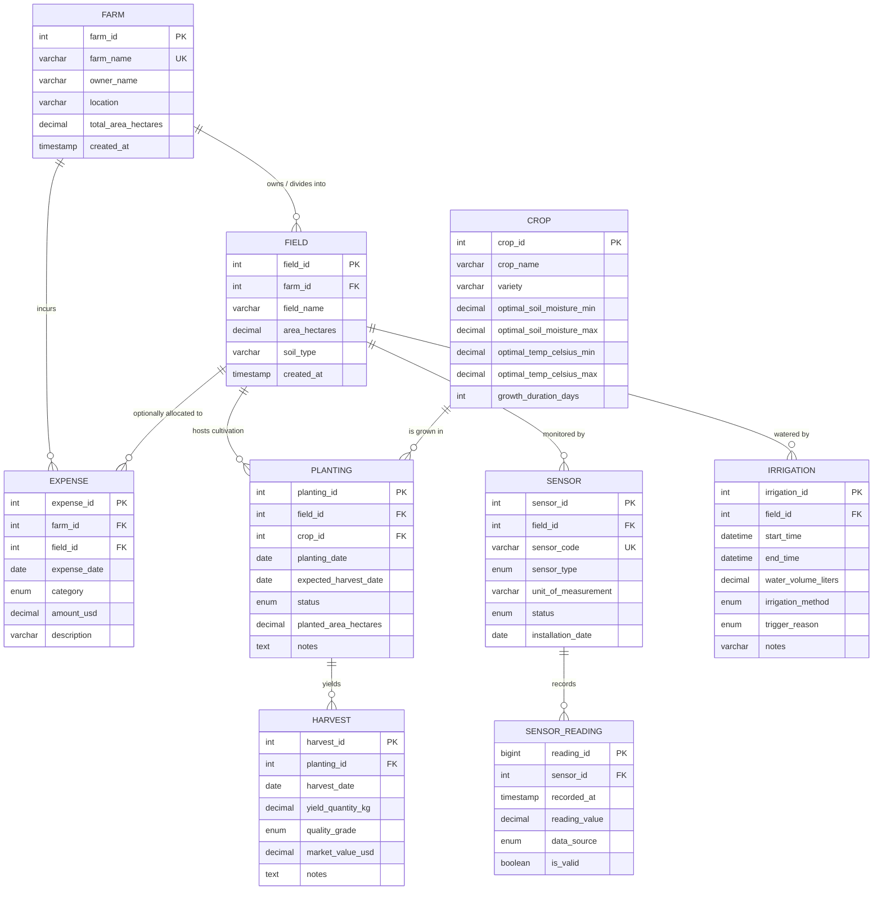

# Smart Farm DBMS — Entity-Relationship (ER) Diagram

**Project:** Smart Farm Database Management System  
**Target Engine:** MySQL 8.x (InnoDB)  
**Document:** Entity-Relationship Specification and Diagram Source  

---

## 1. Visual Entity-Relationship Diagram (Mermaid)

---

## 2. Cardinality and Relationship Rationale

### 1. `FARM` to `FIELD` (1 : N)
- **Cardinality:** One Farm has one or more Fields ($1 \rightarrow N$).
- **Business Logic:** An agricultural property is subdivided into distinct physical plots or parcels with distinct acreage and soil types.
- **Foreign Key:** `field.farm_id` $\rightarrow$ `farm.farm_id`. `ON DELETE RESTRICT` prevents accidental deletion of a farm with active fields.

### 2. `FIELD` and `CROP` to `PLANTING` ($M : N$ resolved)
- **Cardinality:** A Field can host many Crops across successive seasons ($1 \rightarrow N$). A Crop variety can be planted across multiple Fields ($1 \rightarrow N$).
- **Business Logic:** Cultivation is cyclical. `PLANTING` acts as the associative entity storing season-specific attributes (planting date, target harvest date, cycle status like `GROWING` or `HARVESTED`, planted hectares).
- **Foreign Keys:** `planting.field_id` $\rightarrow$ `field.field_id`, `planting.crop_id` $\rightarrow$ `crop.crop_id`.

### 3. `FIELD` to `SENSOR` (1 : N)
- **Cardinality:** One Field has zero, one, or many deployed Sensors ($1 \rightarrow N$).
- **Business Logic:** Hardware identity (MAC/serial/code, sensor type, calibration unit) remains constant regardless of data stream volume.
- **Foreign Key:** `sensor.field_id` $\rightarrow$ `field.field_id`.

### 4. `SENSOR` to `SENSOR_READING` (1 : N)
- **Cardinality:** One Sensor records thousands or millions of time-series readings ($1 \rightarrow N$).
- **Business Logic:** Clear separation between hardware registry (`sensor`) and high-frequency telemetry stream (`sensor_reading`). Supports tracking whether data is simulated (`SIMULATED`) or real hardware telemetry (`REAL`).
- **Foreign Key:** `sensor_reading.sensor_id` $\rightarrow$ `sensor.sensor_id`. Cascades upon sensor removal.

### 5. `FIELD` to `IRRIGATION` (1 : N)
- **Cardinality:** One Field receives many irrigation events over time ($1 \rightarrow N$).
- **Business Logic:** Tracks water volumes applied, start/end timestamps, method (e.g., drip vs. sprinkler), and the triggering reason (e.g., automated response to low soil moisture readings).
- **Foreign Key:** `irrigation.field_id` $\rightarrow$ `field.field_id`.

### 6. `PLANTING` to `HARVEST` (1 : N)
- **Cardinality:** One Planting cycle produces one or multiple harvest batches ($1 \rightarrow N$).
- **Business Logic:** Allows partial picking or multi-stage harvesting over consecutive days for a single planting cycle.
- **Foreign Key:** `harvest.planting_id` $\rightarrow$ `planting.planting_id`.

### 7. `FARM` (and `FIELD`) to `EXPENSE` (1 : N)
- **Cardinality:** One Farm incurs many expenses ($1 \rightarrow N$). A specific expense can optionally be tied to a specific Field ($0..1$).
- **Business Logic:** General overhead (e.g., farm equipment, electricity) connects directly to `farm_id` with `field_id IS NULL`. Plot-specific inputs (fertilizer for Field A) link to both `farm_id` and `field_id`.
- **Foreign Keys:** `expense.farm_id` $\rightarrow$ `farm.farm_id`, `expense.field_id` $\rightarrow$ `field.field_id`.
