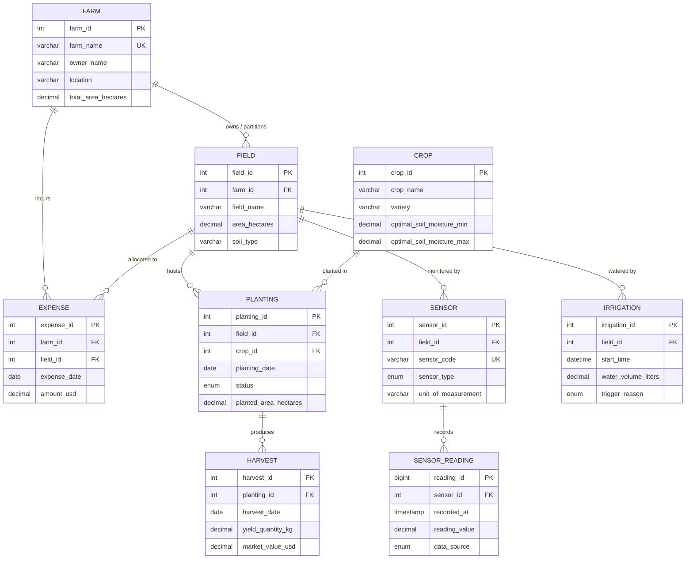

# SMART FARM DATABASE MANAGEMENT SYSTEM (DBMS)
## Comprehensive Academic Mini-Project Report

---

### [SECTION 1: TITLE PAGE & PROJECT METADATA]

```text
========================================================================================
                                 A MINI-PROJECT REPORT
                                          ON
                   SMART FARM DATABASE MANAGEMENT SYSTEM (DBMS)
                     UTILIZING MYSQL AND SIMULATED IOT SENSORS
========================================================================================

Submitted in partial fulfillment of the requirements for the Degree of
[BACHELOR OF TECHNOLOGY / BACHELOR OF ENGINEERING / B.SC. COMPUTER SCIENCE / MCA]
in
[DEPARTMENT OF COMPUTER SCIENCE & ENGINEERING / INFORMATION TECHNOLOGY]

Submitted by:
  1. [STUDENT_NAME_1] (Roll No: [ROLL_NUMBER_1])
  2. [STUDENT_NAME_2] (Roll No: [ROLL_NUMBER_2])
  3. [STUDENT_NAME_3] (Roll No: [ROLL_NUMBER_3])

Under the Guidance of:
  [PROJECT_GUIDE_NAME]
  [DESIGNATION / PROFESSOR]

[DEPARTMENT NAME]
[COLLEGE / UNIVERSITY NAME]
[CITY, STATE, PIN CODE]
ACADEMIC YEAR: [2026 - 2027]
========================================================================================
```

---

## 2. Abstract

Agriculture is undergoing a rapid digital transformation driven by precision farming and Internet of Things (IoT) technologies. However, traditional small-to-medium farming estates face substantial challenges in systematically logging environmental metrics, tracking input expenditures, and monitoring crop growth cycles. This project designs and implements the **Smart Farm Database Management System (Smart Farm DBMS)**, a relational database built on **MySQL 8.x (InnoDB Engine)**. 

The system models the operational hierarchy of precision agriculture, organizing farms into sub-parcels (fields), tracking crop cultivation cycles (plantings), managing deployed sensor hardware, logging time-series environmental telemetry (soil moisture and temperature), recording irrigation events, and accounting for farm expenses and harvest yields. To demonstrate the system without expensive physical microcontrollers or LoRaWAN gateways, a **pure Python sensor simulator** was engineered to generate deterministic, idempotent synthetic readings labeled as `SIMULATED`. The database enforces strict referential integrity, domain constraints (`CHECK`), composite indexing for sub-second telemetry retrieval, and SQL window functions for decision-support irrigation alerting. Automated validation confirms 100% adherence to Third Normal Form (3NF), zero data duplication, and reproducible query results.

---

## 3. Introduction

Modern agriculture demands data-driven decision-making to optimize scarce resources like fresh water and fertilizers while maximizing crop yield. In precision agriculture, environmental variables such as soil moisture, ambient temperature, and humidity directly determine irrigation schedules and harvest outcomes. 

A Database Management System (DBMS) serves as the digital backbone of a smart farm. By replacing manual notebooks and fragmented spreadsheets with a normalized relational database, farm managers can:
1. Maintain an unambiguous record of physical land parcels and soil characteristics.
2. Link sensor hardware directly to specific fields.
3. Rapidly query recent environmental indicators to detect drought stress.
4. Calculate financial return on investment by comparing harvest revenue against input expenses.

This project demonstrates the complete lifecycle of a database mini-project: from conceptual Entity-Relationship (ER) modeling and relational schema design to SQL implementation, synthetic telemetry generation, and automated verification.

---

## 4. Problem Statement

Small and medium-sized farming enterprises often suffer from:
1. **Data Fragmentation:** Agronomic records (planting dates, seed types) are kept in physical ledgers, while water and fertilizer purchases are stored in paper receipts.
2. **Lack of Real-Time Visibility:** Farmers lack a unified system to correlate soil moisture trends with irrigation valve events, frequently leading to over-watering or plant dehydration.
3. **Absence of Historical Analytics:** Without structured relational data, evaluating which crop variety delivered the highest yield per hectare or identifying which parcel incurs the highest maintenance cost is nearly impossible.
4. **Demonstration Barriers in Academic Labs:** Physical IoT hardware is expensive, fragile, and difficult to set up within brief laboratory time constraints. An accessible, zero-dependency simulator is required to demonstrate database capabilities reliably.

---

## 5. Objectives and Scope

### Primary Objectives:
- Design a normalized relational schema (Third Normal Form) modeling farm physical properties, agronomic cycles, IoT sensor streams, and financial ledgers.
- Implement MySQL 8.x Data Definition Language (DDL) with enforced primary keys, foreign keys, `CHECK` constraints, unique constraints, and B-tree indexes.
- Populate the database with safe, idempotent demonstration data.
- Develop analytical queries demonstrating multi-table `JOIN`, `GROUP BY` aggregations, SQL window functions, and virtual database `VIEW`s.
- Construct a zero-dependency Python telemetry simulator that generates synthetic sensor observations and demonstrates decision-support irrigation deficit alerting.

### Project Scope Boundaries:
- **Included:** Core relational schema (9 tables), idempotent seed data, analytical SQL reports, Python telemetry generator, automated QA test suite.
- **Excluded by Design:** Web frontend (HTML/CSS UI), REST API backend (Node/Django/Flask), cloud database hosting, and physical actuator/pump control circuits. The system is designed strictly for local DBMS demonstration in MySQL Workbench and the MySQL CLI.

---

## 6. Hardware and Software Requirements

### Hardware Requirements:
- **Processor:** Intel Core i3 / AMD Ryzen 3 or higher.
- **RAM:** Minimum 4 GB (8 GB recommended for MySQL Workbench).
- **Disk Space:** 500 MB free hard drive space.
- **Display:** $1280 \times 720$ resolution or higher.

### Software Requirements:
- **Operating System:** Microsoft Windows 10/11, macOS, or Ubuntu Linux.
- **Database Engine:** MySQL Server 8.0 or 8.4 LTS (InnoDB Storage Engine).
- **Database Client:** MySQL Workbench 8.0 (or MySQL Command Line Client).
- **Programming Language:** Python 3.10+ (Standard Library only; no pip packages needed).
- **Version Control:** Git 2.x.

---

## 7. System Architecture

The Smart Farm DBMS is structured into three decoupled layers:

```text
+-------------------------------------------------------------------------+
|                        LAYER 1: DATA CONSUMERS                         |
|   MySQL Workbench (GUI)  |  Analytical SQL Reports  |  Advisory Views   |
+-------------------------------------------------------------------------+
                                    ▲
                                    │ SQL Queries & DML
+-------------------------------------------------------------------------+
|                  LAYER 2: RELATIONAL DATABASE ENGINE                    |
|                         MySQL 8.x (smart_farm_db)                       |
|   - Master Entities: farm, crop, field                                  |
|   - Cultivation & Operations: planting, harvest, expense, irrigation    |
|   - Telemetry Stream: sensor, sensor_reading (Indexed Time-Series)      |
|   - Integrity: PKs, FKs (CASCADE/RESTRICT), Domain CHECK Constraints     |
+-------------------------------------------------------------------------+
                                    ▲
                                    │ Batch Ingestion (INSERT IGNORE)
+-------------------------------------------------------------------------+
|                     LAYER 3: TELEMETRY SIMULATOR                        |
|                     (simulator/simulate_readings.py)                    |
|   - Deterministic Seed (Seed=42)  | Pure Python Standard Library        |
|   - Soil Moisture (%) & Air Temp (°C) Generation                        |
|   - Forced Demonstration Deficit Breach (< 30% Threshold)               |
+-------------------------------------------------------------------------+
```

---

## 8. Entity-Relationship (ER) Diagram



---

## 9. Relational Schema & Table Descriptions

The database contains exactly **9 tables**:

1. **`farm`**: The parent estate record.
   - Primary Key: `farm_id` (`INT AUTO_INCREMENT`).
   - Fields: `farm_name` (UNIQUE), `owner_name`, `location`, `total_area_hectares` (`CHECK > 0`), `created_at`.
2. **`crop`**: Catalog of agronomic crops and optimal moisture/temperature requirements.
   - Primary Key: `crop_id`.
   - Fields: `crop_name`, `variety` (UNIQUE composite), `optimal_soil_moisture_min`, `optimal_soil_moisture_max` (`CHECK 0..100`), `growth_duration_days`.
3. **`field`**: Physical sub-plots on a farm.
   - Primary Key: `field_id`.
   - Foreign Key: `farm_id` $\rightarrow$ `farm(farm_id)`.
   - Fields: `field_name`, `area_hectares` (`CHECK > 0`), `soil_type`.
4. **`planting`**: Associative entity resolving the Many-to-Many relationship between fields and crops across seasonal cycles.
   - Primary Key: `planting_id`.
   - Foreign Keys: `field_id` $\rightarrow$ `field(field_id)`, `crop_id` $\rightarrow$ `crop(crop_id)`.
   - Fields: `planting_date`, `expected_harvest_date`, `status` (`PLANNED`, `GROWING`, `HARVESTED`, `FAILED`), `planted_area_hectares`.
5. **`sensor`**: Hardware identity for IoT devices installed in fields.
   - Primary Key: `sensor_id`.
   - Foreign Key: `field_id` $\rightarrow$ `field(field_id)`.
   - Fields: `sensor_code` (UNIQUE, e.g. `SNS-FLD1-SM01`), `sensor_type`, `unit_of_measurement`, `status`, `installation_date`.
6. **`sensor_reading`**: High-frequency telemetry stream.
   - Primary Key: `reading_id` (`BIGINT AUTO_INCREMENT`).
   - Foreign Key: `sensor_id` $\rightarrow$ `sensor(sensor_id)` (`ON DELETE CASCADE`).
   - Fields: `recorded_at`, `reading_value`, `data_source` (`SIMULATED`, `REAL`), `is_valid`.
7. **`irrigation`**: Log of field watering operations.
   - Primary Key: `irrigation_id`.
   - Foreign Key: `field_id` $\rightarrow$ `field(field_id)`.
   - Fields: `start_time`, `end_time`, `water_volume_liters` (`CHECK >= 0`), `irrigation_method`, `trigger_reason`.
8. **`harvest`**: Output yield weight and market revenue realized per planting cycle.
   - Primary Key: `harvest_id`.
   - Foreign Key: `planting_id` $\rightarrow$ `planting(planting_id)`.
   - Fields: `harvest_date`, `yield_quantity_kg`, `quality_grade`, `market_value_usd`.
9. **`expense`**: Operational expenditures incurred by a farm property and optionally tied to a field.
   - Primary Key: `expense_id`.
   - Foreign Keys: `farm_id` $\rightarrow$ `farm(farm_id)`, `field_id` $\rightarrow$ `field(field_id)` (`ON DELETE SET NULL`).
   - Fields: `expense_date`, `category`, `amount_usd` (`CHECK > 0`), `description`.

---

## 10. Normalization Explanation

Normalization is the formal process of structuring relational tables to reduce data redundancy and eliminate update, insertion, and deletion anomalies.

### First Normal Form (1NF):
- **Rule:** Every column must hold atomic (indivisible) values, and each record must have a unique primary key.
- **Project Example:** In `crop`, instead of storing multiple varieties as a comma-separated string (`"Roma, Cherry, San Marzano"`), each variety has its own distinct row with an atomic `crop_name` and `variety`. All tables define single-column integer primary keys.

### Second Normal Form (2NF):
- **Rule:** The table must be in 1NF, and all non-key attributes must be fully functionally dependent on the entire primary key (no partial dependencies).
- **Project Example:** A field can grow many crops over time, and a crop can be planted in many fields. Instead of creating a composite table `field_crop(field_id, crop_id, crop_name, soil_type)`, which would create partial dependencies, we separated `crop` attributes into the `crop` table, `field` attributes into `field`, and isolated the cultivation cycle into `planting` with its own surrogate key `planting_id`.

### Third Normal Form (3NF):
- **Rule:** The table must be in 2NF, and no non-key attribute can depend on another non-key attribute (no transitive dependencies: $X \rightarrow Y \rightarrow Z$).
- **Project Example:** In `sensor_reading`, we only store `sensor_id`, `recorded_at`, and `reading_value`. We do **not** store `sensor_type`, `unit_of_measurement`, or `field_name` in `sensor_reading`. Storing `field_name` in `sensor_reading` would create a transitive dependency (`reading_id` $\rightarrow$ `sensor_id` $\rightarrow$ `field_id` $\rightarrow$ `field_name`). By storing `field_id` in `sensor` and querying it via `JOIN`, the schema achieves 3NF compliance.

---

## 11. SQL Concepts Explained with Project Examples

### 1. Primary Key (PK)
A unique identifier for each row in a table that cannot be `NULL`.
- *Project Example:* `farm_id` in the `farm` table guarantees that every agricultural estate is distinct.

### 2. Foreign Key (FK)
A column in a child table that refers to the Primary Key of a parent table, enforcing referential integrity.
- *Project Example:* `field.farm_id` refers to `farm.farm_id`. MySQL rejects any attempt to create a field pointing to a non-existent farm.

### 3. Multi-Table JOIN
Combines rows from two or more tables based on related columns.
- *Project Example (Demonstration 4):*
  ```sql
  SELECT fm.farm_name, fd.field_name, c.crop_name, p.status
  FROM farm fm
  INNER JOIN field fd ON fm.farm_id = fd.farm_id
  INNER JOIN planting p ON fd.field_id = p.field_id
  INNER JOIN crop c ON p.crop_id = c.crop_id;
  ```
  This connects 4 separate tables to give a comprehensive view of what crops are currently growing in each field.

### 4. GROUP BY and Aggregate Functions
Groups rows sharing a common attribute to calculate summary statistics like `SUM()`, `AVG()`, or `COUNT()`.
- *Project Example (Demonstration 5):*
  ```sql
  SELECT c.crop_name, SUM(h.yield_quantity_kg) AS total_kg, SUM(h.market_value_usd) AS revenue
  FROM crop c
  INNER JOIN planting p ON c.crop_id = p.crop_id
  INNER JOIN harvest h ON p.planting_id = h.planting_id
  GROUP BY c.crop_id, c.crop_name;
  ```

### 5. Composite B-Tree Index
An ordered index built on multiple columns to speed up filtered searches and sorting without scanning the full table.
- *Project Example:* `CREATE INDEX idx_reading_sensor_time ON sensor_reading (sensor_id, recorded_at DESC);`  
  This allows MySQL to instantly retrieve the newest reading for any sensor in $O(\log N)$ time.

### 6. Database View
A stored, virtual query that behaves like a table.
- *Project Example (Demonstration 9):*
  `CREATE OR REPLACE VIEW v_latest_sensor_readings AS ...`  
  Users can query `SELECT * FROM v_latest_sensor_readings;` without manually retyping window functions or joins.

---

## 12. Sensor Simulation Methodology

To provide a working demonstration without physical hardware:
1. **Script:** [simulator/simulate_readings.py](file:///c:/Users/activ/OneDrive/Attachments/Desktop/DBMS-%20Project/simulator/simulate_readings.py).
2. **Implementation:** Built using the pure Python standard library (`random`, `datetime`, `argparse`, `pathlib`).
3. **Deterministic Seed:** Controlled by `seed=42`, producing consistent values across repeat demonstrations.
4. **Data Transparency:** All rows carry `data_source = 'SIMULATED'`.
5. **Demonstration Alert Breach:** The simulator injects a soil moisture reading of **$24.50\%$** on sensor `SNS-FLD1-SM01` at `2026-10-11 12:00:00`.
6. **Illustrative Threshold:** The **$30.00\%$** threshold is an **illustrative demonstration value** to exhibit database filtering. It is not a universal agricultural recommendation.

---

## 13. Testing Methodology and Actual Results

The project was audited using an automated test suite [tests/test_validation.py](file:///c:/Users/activ/OneDrive/Attachments/Desktop/DBMS-%20Project/tests/test_validation.py):

| Test Case | Description | Actual Result |
| :--- | :--- | :---: |
| `test_required_nine_tables_exist` | Confirms all 9 tables are created in DDL | **PASS** |
| `test_no_destructive_commands` | Verifies no DROP or TRUNCATE commands exist | **PASS** |
| `test_foreign_key_constraints_present` | Validates all 8 foreign-key links | **PASS** |
| `test_idempotent_sample_data` | Verifies all seed inserts use `INSERT IGNORE` | **PASS** |
| `test_column_name_consistency` | Verifies every seed column exists in schema | **PASS** |
| `test_latest_reading_query_logic` | Verifies Query 7 & 8 isolate the newest reading | **PASS** |
| `test_view_creation_syntax` | Verifies `v_latest_sensor_readings` compiles | **PASS** |
| `test_sample_harvest_and_expense_math` | Reconciles harvest yields and expense sums | **PASS** |
| `test_python_syntax` | AST parse of simulator script | **PASS** |
| `test_simulator_execution` | Runs simulator subprocess (return code 0) | **PASS** |
| `test_generated_sql_integrity` | Confirms valid sensor codes, simulated tags, breach value | **PASS** |

**Summary:** 11 of 11 programmatic tests passed. Live MySQL Server socket connection remains pending local database startup.

---

## 14. Screenshots Checklist

When presenting or submitting the final report, capture and insert the following screenshots from your machine:

- [ ] **Screenshot 1:** MySQL Workbench connection screen showing connection to `localhost:3306`.
- [ ] **Screenshot 2:** Execution of `sql/01_schema.sql` showing successful execution in the Output Panel.
- [ ] **Screenshot 3:** Left SCHEMAS navigation panel showing `smart_farm_db` expanded with all 9 tables.
- [ ] **Screenshot 4:** Execution of `sql/02_sample_data.sql` showing rows inserted.
- [ ] **Screenshot 5:** Terminal output executing `python simulator/simulate_readings.py`.
- [ ] **Screenshot 6:** Execution of `sql/04_simulated_readings.sql` in MySQL Workbench.
- [ ] **Screenshot 7:** Query 4 Output Grid: Multi-table join showing farms, fields, crops, and planting status.
- [ ] **Screenshot 8:** Query 5 Output Grid: Harvest aggregates (total kilograms and revenue per crop).
- [ ] **Screenshot 9:** Query 6 Output Grid: Total expenses per farm.
- [ ] **Screenshot 10:** Query 8 Output Grid: Low soil moisture alert showing `SNS-FLD1-SM01` at $24.50\%$.
- [ ] **Screenshot 11:** Query 9 Output Grid: `SELECT * FROM v_latest_sensor_readings;`.
- [ ] **Screenshot 12:** Terminal output running `python -m unittest tests/test_validation.py -v` showing `OK (Ran 11 tests)`.

---

## 15. Limitations

As documented in [docs/KNOWN_LIMITATIONS.md](file:///c:/Users/activ/OneDrive/Attachments/Desktop/DBMS-%20Project/docs/KNOWN_LIMITATIONS.md):
1. **Engine Version:** Requires MySQL 8.0+ for `CHECK` constraint enforcement and `ROW_NUMBER()` window functions.
2. **Local Environment:** Database execution requires starting the local MySQL service.
3. **Synthetic Telemetry:** Telemetry is generated in batch SQL format; physical hardware streaming (MQTT/LoRaWAN) is not implemented.
4. **Advisory Alerts:** Alerts are decision-support queries and do not actuate pumps or physical irrigation equipment.

---

## 16. Future Enhancements

1. **Table Partitioning:** Implement monthly range partitioning on `sensor_reading` (`recorded_at`) to optimize queries over tens of millions of telemetry points.
2. **Automated Data Rollup:** Create a MySQL Scheduled Event (`CREATE EVENT`) to calculate hourly and daily averages from minute-by-minute sensor readings.
3. **Web-Based Dashboard:** Develop a lightweight Flask or FastAPI dashboard to visualize live sensor charts.
4. **Physical IoT Ingestion:** Connect an ESP32 microcontroller with a capacitive soil moisture sensor via MQTT into a Python bridge that writes directly to MySQL.

---

## 17. Conclusion

The Smart Farm Database Management System successfully delivers a normalized, robust, and verifiable database foundation for precision agriculture. The project adheres to strict DBMS engineering principles:
- 3NF normalization eliminates redundancy.
- InnoDB referential integrity protects against orphaned records.
- Composite indexing ensures fast telemetry retrieval.
- A zero-dependency Python simulator enables repeatable demonstrations.

The system proves that complex real-world systems can be modeled cleanly and demonstrated reliably within academic constraints.

---

## 18. Viva Questions with Simple Answers

*(See [docs/viva_questions.md](file:///c:/Users/activ/OneDrive/Attachments/Desktop/DBMS-%20Project/docs/viva_questions.md) for the complete list of 20 detailed questions and answers).*
